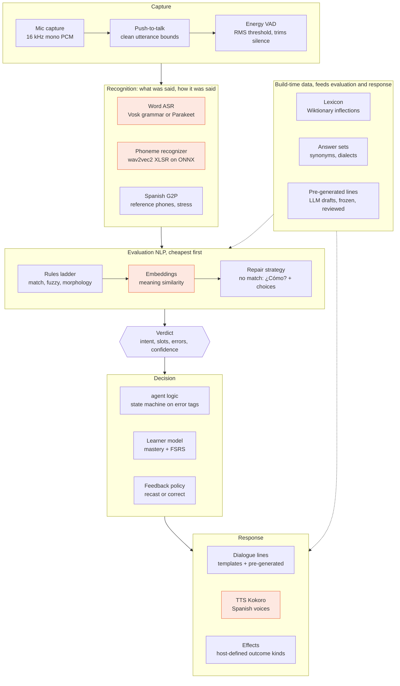

> **Archived 2026-11-03** from `docs/nlp/history/HIGH_LEVEL_DOCS.md`: the original design note. The pipeline as it is now: [PIPELINE.md](../../../nlp/PIPELINE.md).

> the original design note (2026-10-18), kept for history

# Voice Recognition & Feedback System — High-Level Design

Oct 18, 2026 · @James

## Overview

The host hears the player speak Spanish, judges what they meant and how well they said it, and reacts. **Every runtime step is deterministic**: the same audio clip, host state and content version always produce the same verdict, feedback and host outcome. Non-deterministic capabilities (LLMs, sampled models) are documented per step as optional extensions with strict rules for adding them.

**Purpose:** the language core of a host application in which speaking Spanish is part of the interaction (agent dialogue, answers and feedback). The host's own design is outside this document.

**In scope:** speech capture, word recognition, pronunciation scoring, language evaluation, verdict, decisions, learner model, agent responses (text and speech), effects, and the build-time content pipeline.

**Constraints:**

- No paid or hosted AI services. Everything runs locally and offline.
- Implementation language: Rust, C# or Go (see Technology choices).
- Deterministic runtime, as defined in the determinism model below.
- Runs alongside the host on consumer hardware.

## Determinism model

Every component belongs to one of three classes; the runtime core uses only D0 and D1.

| Class | Definition | Examples | Guarantee |
| --- | --- | --- | --- |
| **D0 — Algorithmic** | Plain code: rules, lookups, DSP, fixed-order math | G2P, rules ladder, FSRS, state machines | Identical output on every machine |
| **D1 — Frozen inference** | Neural model with frozen weights, greedy/argmax decoding, pinned runtime, fixed thread count, CPU execution | ASR, phoneme recognizer, embeddings, TTS | Identical on the same platform build; verified by golden tests; decisions use margins so float drift cannot flip outcomes |
| **N — Non-deterministic** | Sampled generation, or output not reproducible run to run | Runtime LLM, sampled TTS, Whisper temperature fallback | Not in the core. Extension only, under the patterns below |

**Hard rules**

1. No N-class output may change the verdict, the learner model, or host state.
2. All randomness (dialogue variant choice and any other host draw) uses a seeded RNG: `seed = hash(world_seed, agent_id, interaction_counter)`.
3. Time-dependent logic uses timestamps stored in the save, never live wall-clock reads during evaluation.
4. Model files, runtime versions and content data are pinned and hashed; hashes go into saves and replay logs.
5. Every threshold uses a margin: accept only if `score ≥ t + ε`, reject only if `score ≤ t − ε`, otherwise take the defined "uncertain" branch.

**Patterns for adding non-deterministic capabilities.** Any LLM or N-class capability must use one of these. Each component below names which would apply.

| Pattern | How it works | Resulting determinism |
| --- | --- | --- |
| **Freeze** (preferred) | LLM runs at build time on dev machines; humans review; output ships as versioned data | Fully deterministic at runtime |
| **Cache** | Runs once at runtime; output stored in the save, keyed by `hash(input, context, model_version)`; identical inputs replay it | Deterministic per save after first occurrence |
| **Advisory** | Cosmetic only (flavor text); validated by D0 rules; deterministic fallback on failure; never touches verdict or state | Gameplay deterministic; presentation may vary |

Cache and Advisory are reserved for an optional, clearly labeled conversation mode (Roadmap, Phase 3).

Guiding principle carried over from gameplay: **reward communication, coach correctness.** If the player was understood, the world responds; correction rides on the response.

## Architecture overview

Audio flows top to bottom through five runtime tiers. The verdict is the waist of the hourglass: tiers above produce it, tiers below consume it.



Build-time data is produced on developer machines and shipped as files, so the heaviest LLM work never runs on the player's machine.

## Components

Sixteen steps, each with its deterministic design, output, class, and non-deterministic considerations. A summary table closes the section.

### 1. Audio capture and segmentation

**Deterministic design:** push-to-talk defines utterance boundaries (no always-listening mode in the core). Energy-based VAD (RMS threshold + hangover frames) trims silence. Fixed resampler to 16 kHz mono and fixed gain normalization. Mic input via `cpal` (Rust), `malgo` (Go), or the engine's capture API / NAudio (C#).

**Output:** 16 kHz mono PCM clip + clip hash. **Class:** D0.

**Non-deterministic considerations:** Silero VAD (D1) handles noisy rooms better; acceptable later as a D1 upgrade. Always-listening mode makes segmentation timing-dependent; avoid for graded prompts. No LLM role.

### 2. Word recognition (ASR)

**Deterministic design:** two modes chosen per prompt by content data.

- **Constrained** (spells, item names, quiz): Vosk with a phrase grammar from the prompt's answer set plus `[unk]`; n-best alternatives. Most prompts use this.
- **Open** (free answers): Parakeet TDT 0.6B v3 (int8) via sherpa-onnx.

Greedy or fixed-width beam, no temperature, no sampling, fixed threads, CPU, pinned versions.

**Output:** transcript, n-best with scores, word timestamps and confidences. **Class:** D1.

**Non-deterministic considerations:** Whisper's temperature fallback is stochastic; disable it if Whisper is ever used. LLM-based ASR decoders (Qwen3-ASR) are D1 with greedy decoding but tend to rewrite speech fluently; benchmark on learner errors first. LLM transcript correction is rejected: it hides the mistakes the host must detect.

### 3. Pronunciation reference (Spanish G2P)

**Deterministic design:** in-house rule-based converter. Normalize → group digraphs (`ch ll rr qu gu`) → syllabify → assign stress → context-sensitive phone mapping → cross-word allophone pass (`b d g` → `β ð ɣ`, nasal assimilation, `s` voicing) → exception lexicon (loanwords, `México`, `subrayar`). Dialect config (seseo/distinción, yeísmo, `ll` sound, `s` aspiration) yields all accepted variants. Keeps grapheme alignment per syllable for UI highlighting. Also generates predicted English-speaker error variants (`ɾ→ɹ`, pronounced `h`, vowel reduction) for targeted feedback.

**Output:** reference phone sequences (accepted + predicted-error variants), alignment, stress. **Class:** D0.

**Non-deterministic considerations:** Freeze — an LLM may propose exception-list entries at build time for human review. espeak-ng only as a dev-only test oracle. No runtime LLM role.

### 4. Pronunciation scoring

**Deterministic design:** phoneme recognizer (wav2vec2-xlsr-53-espeak-cv-ft, ONNX) → frame posteriors → CTC forced alignment (Viterbi) against each accepted variant → per-phone GOP score → low scores matched to predicted-error variants for specific tags (`pron.r`) → fixed per-phone-class thresholds by difficulty, with margins. v1 fallback: greedy phone decode + edit distance.

**Output:** per-phone scores with grapheme spans, pronunciation error tags, word score. **Class:** D1 model + D0 scoring.

**Non-deterministic considerations:** Freeze — LLM drafts articulatory tips per error tag at build time; shipped as an authored tip table. No runtime LLM needed.

### 5. Text normalization

**Deterministic design:** lowercase, Unicode NFC, number words ↔ digits, punctuation removal, contractions (`al`, `del`). Written accents kept for lookup, never penalized in speech.

**Output:** normalized tokens. **Class:** D0. **Non-deterministic considerations:** none.

### 6. Answer matching

**Deterministic design:** cheapest first, stop at first confident result: exact match → alias match (synonyms, dialect variants such as `coche`/`carro`/`auto`) → fuzzy match (edit distance + Spanish phonetic key collapsing `b/v`, `ll/y`, `s/z/c`). A near miss is tagged as likely pronunciation, not knowledge.

**Output:** answer ID or none, match type, distance. **Class:** D0.

**Non-deterministic considerations:** Freeze — LLM expands alias sets at build time; humans approve. Runtime "is this acceptable?" LLM judgment is rejected.

### 7. Linguistic analysis

**Deterministic design:** tokenize; lemma and features (person, number, tense, mood, gender) from the build-time lexicon; agreement rules (subject–verb, article–noun, noun–adjective, quantity–noun); per-exercise slot grammar (e.g. `quiero [ART] [NOUN:item]`) via a deterministic PEG or chart parser; error tags from rule violations.

**Output:** parse, slot values, grammar error tags with spans and expected forms. **Class:** D0.

**Non-deterministic considerations:** a statistical tagger (UDPipe, D1) could widen coverage; check model licenses. Advisory/Cache — in optional conversation mode an LLM may parse sentences outside the slot grammar; its suggested tags count only if D0 rules confirm them. Error explanations come from authored templates per tag.

### 8. Meaning and intent

**Deterministic design:** fixed order — slot grammar match in current agent context → lemma keyword rules (lemma `comprar` + item → `buy_item`) → embedding nearest neighbor (multilingual-e5-small, ONNX) against authored examples per intent, accepted only if `top1 ≥ t` and `top1 − top2 ≥ m`. Unresolved → deterministic repair: agent says "¿Cómo?", repeats slower, then offers 2–3 spoken choices and switches to constrained ASR for the retry.

**Output:** intent ID or `Unknown`, slots, resolving rung, margin. **Class:** D0 + one D1 rung.

**Non-deterministic considerations:** Cache/Advisory — in optional conversation mode an LLM may classify intent, grammar-constrained (GBNF/JSON schema) to known intent IDs, must pass slot validation, cached per input hash, never on graded prompts. Freeze — LLM generates extra example utterances per intent at build time.

### 9. Verdict assembly

**Deterministic design:** `communicated` = intent resolved and required slots filled; `correctness` = 1 − weighted grammar penalties (weights in data); `pronunciation` = aggregated content-word phone scores; `confidence` = minimum of stage confidences; thresholds per difficulty; ties broken in fixed order.

**Output:** Verdict. **Class:** D0.

**Non-deterministic considerations:** none. **Hard rule: no N-class input reaches this step.**

### 10. agent logic

**Deterministic design:** state machines or behavior trees keyed on intent and error tags; variation only through the seeded RNG.

**Output:** agent action, dialogue intent, host event. **Class:** D0.

**Non-deterministic considerations:** Advisory — LLM flavor lines in optional conversation mode; never changes agent state or host state.

### 11. Learner model and scheduling

**Deterministic design:** per-skill mastery via fixed-parameter model (Bayesian Knowledge Tracing or Elo-style) from error tags; FSRS schedules reviews using stored timestamps; deterministic priority queue picks content for weak skills.

**Output:** mastery vector, review schedule, next content. **Class:** D0.

**Non-deterministic considerations:** Freeze — LLM drafts progress-summary templates at build time. Runtime LLM coaching out of scope.

### 12. Feedback policy

**Deterministic design:** rule table `(error tag, repeat count, difficulty) → feedback type`: recast, hint, explicit correction, model pronunciation (reference audio), slow repeat.

**Output:** feedback plan. **Class:** D0.

**Non-deterministic considerations:** Freeze — LLM-drafted hint and exercise pools tagged by skill and CEFR level, reviewed before shipping.

### 13. Response realization

**Deterministic design:** template engine with morphological generation from the lexicon, so `¿Tienes {qty} {item:plural-if(qty)}?` → "¿Tienes dos espadas?". Recasts are built from the player's own slots. Variants chosen by seeded RNG. CEFR vocabulary check at build time.

**Output:** response text + phone data for TTS. **Class:** D0.

**Non-deterministic considerations:** Freeze (preferred) — LLM drafts dialogue variants at build time. Cache + Advisory — runtime LLM dialogue in optional conversation mode only, filtered by CEFR list and banned-content rules, template fallback.

### 14. Speech output (TTS)

**Deterministic design:** static lines pre-rendered at build time. Dynamic lines use Kokoro-82M with fixed voice vectors and phonemes from the in-house G2P; cached by text hash; CI checks byte-identical output on a golden set.

**Output:** audio buffer. **Class:** D0 for static lines, D1 for dynamic.

**Non-deterministic considerations:** sampled TTS (e.g. Piper with non-zero noise scale) varies per run; set noise to zero or seed it. Voice cloning out of scope.

### 15. Effects

**Deterministic design:** fixed mapping tables from verdict to effect; partial credit → partial effect (for example 60% of the full effect).

**Output:** host state changes. **Class:** D0. **Non-deterministic considerations:** none permitted.

### 16. Build-time content pipeline

**Deterministic design:** lexicon and inflection tables from Wiktionary dumps (kaikki.org / wiktextract); answer sets, aliases, intents and example utterances per prompt; dialogue templates, variant pools, pre-rendered audio; CEFR lists. All versioned, hashed, reproducibly built; content hash stored in saves.

**Output:** versioned content bundle. **Class:** offline; runtime sees only frozen data.

**Non-deterministic considerations:** the intended home for LLM work (Freeze). A larger local model drafts synonyms, dialogue, hints, exercises and example utterances; each item carries `generated_by` and needs human approval.

### Step summary

| Step | Deterministic core | Class | LLM / N-class consideration | Pattern |
| --- | --- | --- | --- | --- |
| 1 Capture | Push-to-talk, energy VAD | D0 | None | — |
| 2 ASR | Vosk grammar / Parakeet, greedy | D1 | No Whisper temp fallback; no LLM correction | — |
| 3 G2P | Rule-based | D0 | Propose exceptions | Freeze |
| 4 Pronunciation | CTC + Viterbi + GOP | D1+D0 | Articulation tips | Freeze |
| 5 Normalize | Rules | D0 | None | — |
| 6 Matching | Exact, alias, fuzzy | D0 | Expand synonyms | Freeze |
| 7 Linguistics | Lexicon, agreement, slot grammar | D0 | Parse open speech; rules confirm | Advisory/Cache |
| 8 Intent | Grammar, rules, embeddings + margin | D0+D1 | Classify open speech; more examples | Cache / Freeze |
| 9 Verdict | Fixed combination rules | D0 | **Forbidden** | — |
| 10 agent logic | State machines, seeded RNG | D0 | Flavor lines | Advisory |
| 11 Learner model | BKT/Elo + FSRS | D0 | Summary templates | Freeze |
| 12 Feedback | Rule table | D0 | Hint/exercise pools | Freeze |
| 13 Realization | Templates + morph generation | D0 | Dialogue variants; free conversation | Freeze / Cache+Advisory |
| 14 TTS | Pre-rendered + Kokoro fixed voice | D0/D1 | Seed any sampled TTS | — |
| 15 Effects | Mapping tables | D0 | **Forbidden** | — |
| 16 Build pipeline | Versioned data | Offline | Primary LLM home | Freeze |

## Verdict contract and error taxonomy

Every utterance produces exactly one verdict. It separates whether the player communicated from whether they were correct.

```
Verdict {
  intent:        IntentId | Unknown
  slots:         Map<SlotName, Value>          // e.g. item=espada, qty=2
  communicated:  bool
  correctness:   0.0..1.0
  errors:        [ErrorTag { tag, span, expected, actual }]
  pronunciation: [PhoneScore { grapheme_span, expected, actual, score }]
  confidence:    0.0..1.0
  resolved_by:   Exact | Alias | Fuzzy | Grammar | Rules | Embedding | Unresolved
  versions:      { content_hash, model_hashes }   // for replay
}
```

Worked example: at the blacksmith, the player says "yo tiene dos espada". Verdict: intent `offer_item`, slots `item=espada, qty=2`, communicated `true`, errors `conj.person` (tiene → tengo) and `noun.number` (espada → espadas). The trade happens; the blacksmith recasts from the player's own slots: "¿Tienes dos espadas? ¡Perfecto!"

Starting error taxonomy (beginner to intermediate). Tags are stable IDs; the learner model and feedback templates key off them.

| Tag | Meaning | Example |
| --- | --- | --- |
| `vocab.wrong` | Wrong word for the concept; `expected` is the answer set's canonical word when the set has exactly one answer, otherwise empty (M17c, [docs/nlp/PIPELINE.md](../../../nlp/PIPELINE.md)) | *perro* for *gato* |
| `vocab.unknown` | Word not in lexicon; after a fuzzy answer match `expected` is the canonical word of the answer (M17c, [docs/nlp/PIPELINE.md](../../../nlp/PIPELINE.md)) | *espado* |
| `conj.person` | Verb person/number mismatch | *yo tiene* |
| `conj.tense` | Wrong tense | *ayer como* |
| `conj.irregular` | Regularized irregular verb | *yo sabo* |
| `gender.agree` | Article/adjective gender mismatch | *el mesa* |
| `noun.number` | Singular/plural mismatch | *dos espada* |
| `ser_estar` | Ser/estar confusion | *soy cansado* |
| `word_order` | Non-Spanish word order | *el rojo coche* (unmarked) |
| `pron.vowel` | Vowel reduced or diphthongized | *casa* → ˈkasə |
| `pron.r` | Tap/trill error | *perro* with ɹ |
| `pron.silent_h` | Pronounced *h* | *hola* said /hola/, not /ola/ |
| `pron.stress` | Stress on wrong syllable | *TEléfono* |

Open question: whether to add subjunctive, por/para and pronoun-placement tags in v1 or later.

## Technology choices

Recommendation: **C#**, with Rust as a strong alternative. C# has the widest local-AI tooling and an official ONNX Runtime package. Go is workable but has the thinnest ecosystem.

| Need | Tool | C# | Rust | Go |
| --- | --- | --- | --- | --- |
| ASR runtime, TTS host | [sherpa-onnx](https://docsearch.algolia.com/mcp/docs/repo/k2-fsa/sherpa) | NuGet | [crate](https://docs.rs/sherpa-onnx) | module |
| Constrained ASR | [Vosk](https://pkg.go.dev/github.com/alphacep/vosk-api/go) | NuGet | `vosk` crate | official (cgo) |
| Phoneme model, embeddings | ONNX Runtime | official | `ort` | community |
| *Extension only:* local LLM | llama.cpp | [LLamaSharp](https://summary.ecosyste.ms/projects/124668) | `llama-cpp-2`, mistral.rs | yzma, [gollama.cpp](https://github.com/dianlight/gollama.cpp) |
| *Extension only:* Whisper | whisper.cpp | Whisper.net | whisper-rs | [bucky](https://pkg.go.dev/github.com/ardanlabs/bucky) |

Core model choices:

| Role | Primary | Alternatives | Size (approx.) |
| --- | --- | --- | --- |
| Constrained ASR | Vosk small Spanish | — | ~50 MB |
| Open ASR | [Parakeet TDT 0.6B v3](https://spokenly.app/blog/parakeet-models) int8 | [Qwen3-ASR 0.6B](https://k2-fsa.github.io/sherpa/onnx/qwen3-asr/index.html), [Cohere Transcribe](https://k2-fsa.github.io/sherpa/onnx/cohere_transcribe/index.html) | ~0.67 GB |
| Phonemes | [wav2vec2-xlsr-53-espeak-cv-ft](https://www.promptlayer.com/models/wav2vec2-xlsr-53-espeak-cv-ft) (quantized) | — | ~0.3–1.2 GB |
| Embeddings | multilingual-e5-small | paraphrase-multilingual-MiniLM | ~100–500 MB |
| TTS | [Kokoro-82M](https://awesome.ecosyste.ms/projects/github.com%2Fpguso%2Fkokoro) (Spanish voices) | [piper-plus](https://www.nuget.org/packages/PiperPlus.Core/) (MIT fork) | ~330 MB |
| *Build-time LLM (Freeze)* | Qwen3 (Apache-2.0), any size dev hardware allows | Gemma (check terms) | dev machines only |

Reference for pronunciation scoring: [OpenPronounce](https://github.com/Halleck45/OpenPronounce) (Wav2Vec2 + DTW, Python, English) and the GOP alignment approach in [this paper](https://arxiv.org/pdf/2309.07739).

## Determinism verification, testing and performance

Determinism is proven, not assumed: every graded interaction is replayable, and CI fails on any verdict change.

**Verification and testing**

- **Replay logs:** each graded interaction can be logged as `(clip, host state, content hash, model hashes) → verdict`. Replay must reproduce the verdict exactly. Bug reports attach replay logs.
- **Golden audio set:** recorded learner utterances (non-native speakers, varied accents and mics) with expected verdicts; runs in CI.
- **Cross-platform matrix:** golden set runs on every shipped OS/CPU target (x86-64, ARM64). Divergence beyond margins fails the build.
- **G2P golden set:** thousands of Spanish words with IPA from Wiktionary; espeak-ng as dev-only diff oracle.
- **Evaluator unit tests:** one positive and one negative test per error tag.
- **ASR benchmark harness:** word error rate, learner-error preservation rate and latency per model and mode.
- **Runtime pinning:** ONNX Runtime and model files pinned; intra-op thread count fixed; CPU execution provider for all grading paths.

**Performance budget** (targets to confirm on a min-spec machine; inference on worker threads; models load lazily per mode)

| Stage | Latency target | Memory |
| --- | --- | --- |
| Constrained ASR (Vosk) | < 150 ms after key release | ~50–300 MB |
| Open ASR (Parakeet int8) | < 400 ms for a 3 s clip | ~0.7 GB |
| Pronunciation scoring | < 300 ms, parallel with ASR | ~0.3–1.2 GB |
| Evaluation D0 rungs | < 5 ms | negligible |
| Embeddings | < 50 ms | ~100–500 MB |
| Response + TTS (dynamic) | < 300 ms to first audio | ~330 MB |
| *Extension: runtime LLM* | first token < 1 s | ~1–2.5 GB |

## Licensing

The shipped stack can stay permissive if two GPL components are kept out of the binary: espeak-ng and the current Piper runtime. Verify every license before release; this table is a starting point, not legal advice.

| Component | License | Implication |
| --- | --- | --- |
| sherpa-onnx, Vosk | Apache-2.0 | Ship freely |
| whisper.cpp / Whisper | MIT | Ship freely |
| Parakeet TDT 0.6B v3 | CC-BY-4.0 | Attribution in credits |
| Kokoro-82M | Apache-2.0 | Ship freely; replace its espeak-ng phonemizer with in-house G2P |
| Piper (OHF-Voice/piper1-gpl) | [GPL-3.0](https://github.com/OHF-voice/piper1-gpl/releases) since 2025 | Avoid embedding; original MIT repo is archived |
| espeak-ng | GPL-3.0 | Dev-only test oracle; do not ship |
| Qwen3 | Apache-2.0 | Ship freely |
| Gemma | Custom terms | Review before redistribution |
| Wiktionary-derived data | CC BY-SA | Attribution; share-alike applies to the derived data files |

## Risks and open questions

The biggest risk is recognition quality on real learner speech, which benchmarks do not measure. The second is D1 drift across hardware; margins and the cross-platform matrix contain it.

| Risk | Impact | Mitigation |
| --- | --- | --- |
| ASR auto-corrects learner errors | Grammar mistakes undetected | Constrained mode; phoneme cross-check; n-best comparison; benchmark learner-error preservation |
| Non-native accents raise error rates | False "wrong" verdicts | Golden learner set from week one; repair strategy ("¿Cómo?") before marking wrong |
| D1 float drift across CPUs | Different verdicts per machine | Margins on every threshold; cross-platform CI matrix; CPU-only grading |
| Closed grammars feel restrictive | Players feel unheard | Repair strategy; broad alias sets via Freeze; open mode where content allows |
| Memory pressure on min-spec | Stutter or crashes | Lazy loading; int8 models; no LLM in core |
| Dialect bias in reference | Penalizing valid Latin American speech | Dialect config; accept all regional variants |
| GPL dependency creep | Forced license change | CI license scan; in-house G2P |

**Open questions**

- [ ] Min-spec hardware target (RAM, CPU generation, GPU optional or not)?
- [x] Default dialect for agent speech: Latin American neutral (ADR 0005). Whether a host lets its learner choose another is the host's decision.
- [ ] Microphone privacy: is audio ever stored (e.g. opt-in to improve the golden set)?

## Roadmap

The first target a host can use is Phase 1: closed-answer prompts with pronunciation feedback, fully deterministic, no LLM. Each phase starts only after the gate before it passes.

```mermaid
flowchart LR
    P0[0 · Foundations<br/>golden learner audio<br/>ASR benchmark harness<br/>verdict struct locked<br/>error taxonomy v1<br/>language (ADR 0001)]
    G1{{Gate: models chosen<br/>WER, latency measured}}
    P1[1 · Core loop v0<br/>push-to-talk + VAD<br/>Vosk grammar ASR<br/>G2P + phone distance<br/>rules ladder steps 1-5<br/>templates + Kokoro]
    G2{{Gate: golden set passes<br/>replay reproduces verdict}}
    P2[2 · Open answers<br/>Parakeet open ASR<br/>embeddings rung<br/>GOP phone scoring<br/>learner model + FSRS<br/>feedback policy]
    G3{{Gate: min-spec budget<br/>cross-platform CI green}}
    P3[3 · Extensions<br/>build-time LLM Freeze<br/>optional conversation mode<br/>Cache + Advisory only<br/>CEFR output filter]
    P0 --> G1 --> P1 --> G2 --> P2 --> G3 --> P3
```

Phases are ordered, not dated; dates follow once the min-spec target and team size are set.

Phases 0–2 contain no N-class components. Phase 3 is optional; the build-time (Freeze) LLM pipeline can start earlier because it never affects runtime determinism.