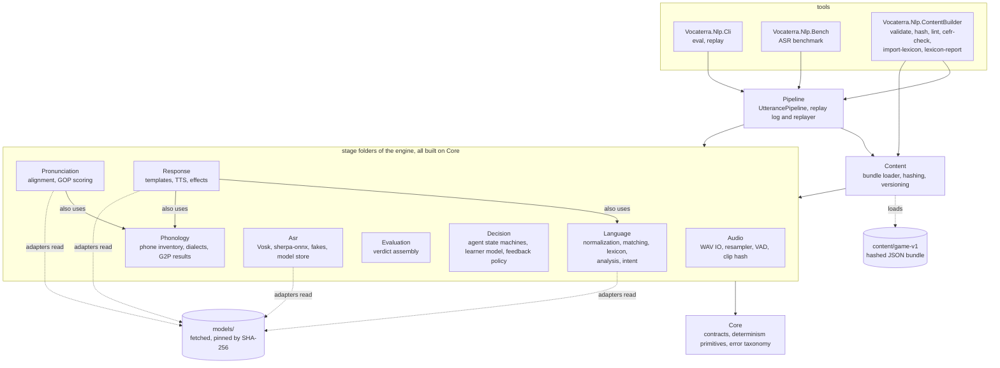

# Vocaterra.NLP

> This document covers the language core: the language-neutral engine `Vocaterra.Nlp` (one assembly, `src/Vocaterra.Nlp`, ADR 0012), the Spanish language pack `Vocaterra.Nlp.Es` (`src/Vocaterra.Nlp.Es`, M53), their tests and its tools (`tests/`, `tools/`) in the Vocaterra repository. The game
> (`docs/game/README.md`) sits beside it in the same solution and references the core's projects directly. Paths below are relative to the
> repository root.

Vocaterra.NLP is a standalone Spanish voice-and-language evaluation core, written in C# on .NET. Given an utterance (audio, or a transcript
for development), it works out what the learner meant and how well they said it, and returns one deterministic **verdict**, with tagged
errors such as `conj.person` or `pron.r`, a feedback plan, a conversation step and the response text. It is a library first: a host loads a
content bundle, builds the services, evaluates utterances and plans responses; [docs/nlp/API.md](API.md) lists the calls in order. The
`Vocaterra.Nlp.Cli` tool is a demo host that drives the same API from the command line. Hosts live outside the core; nothing host-specific (scenes, items, prices, rewards) is in the core. There is one content bundle in the
repository, the game's `content/game-v1`; the core's demo CLI and its tests run on it (R02, [ADR 0009](adr/0009-core-and-game-boundary.md)), and a game edit that
breaks the core fails a core test.

The verdict separates whether the learner *communicated* (the agent understood) from whether they were *correct* (grammar, vocabulary,
pronunciation). The guiding principle is to reward communication and coach correctness: if the learner was understood the conversation
responds, and the correction rides along on the response, for example as a recast ("Claro, «yo quiero dos espadas»").

**Every runtime step is deterministic.** The same audio clip, host state and content version always produce the same verdict, feedback and outcome. Algorithmic stages are plain code with fixed-order math; the neural models (speech recognition, phoneme recognition, embeddings, speech synthesis) are frozen, run greedily on one CPU thread, and are pinned by SHA-256, with a margin on every threshold so floating-point drift cannot flip an outcome. Every graded interaction can be written to a replay log and re-checked later without the models. The libraries are engine-agnostic; the host engine is still an open decision ([docs/nlp/DECISIONS.md](DECISIONS.md)).

## Architecture



The language lives outside the engine: `Vocaterra.Nlp.Es` references `Vocaterra.Nlp` and a host registers it (`SpanishContent.Load`, `LanguagePacks.Default.WithSpanish()`); the engine cannot reference it (ADR 0012).
The dependency direction is `Core` <- stage libraries <- `Content` <- `Pipeline` <- tools, with no cycles; only `Pronunciation` and
`Response` reference a sibling (see [ADR 0003](adr/0003-engine-agnostic-core.md)). For what each stage does with a real
utterance, read [docs/nlp/PIPELINE.md](PIPELINE.md).

The same system is also drawn as a one-page draw.io diagram in
[docs/nlp/diagrams/system-overview.drawio](diagrams/system-overview.drawio); [docs/nlp/diagrams/README.md](diagrams/README.md) explains how to open it.

## Prerequisites

- **.NET SDK 10.0.402**, pinned in `global.json` (`rollForward: latestPatch` allows later patch releases). Projects target `net10.0`.
- A user-local install is enough; no administrator rights are needed:

  ```bash
  curl -sSL https://dot.net/v1/dotnet-install.sh -o dotnet-install.sh
  bash dotnet-install.sh --version 10.0.402 --install-dir "$HOME/.dotnet"
  export DOTNET_ROOT="$HOME/.dotnet"
  export PATH="$HOME/.dotnet:$PATH"
  ```

  Put the two `export` lines in your shell profile, or run them at the start of every shell. `dotnet --version` inside the
  repository should print `10.0.402`.
- On Linux the ICU libraries (`libicu`) must be installed: invariant globalization is deliberately off ([ADR 0006](adr/0006-globalization-icu.md)).
- To fetch models: `bash`, `python3`, `curl`, `sha256sum` (or `shasum`), and `unzip` or `tar` with bzip2.
- A full build writes roughly 3 GB of `bin/` and `obj/` output because of the native speech packages. Make room, and delete
  the output with `git clean -fdX -- src tests tools` when you are done with a checkout.

## Build, test, format

```bash
dotnet restore
dotnet build -warnaserror
dotnet test
dotnet format                       # apply the formatting rules
dotnet format --verify-no-changes   # what CI checks
```

Tests that need a real model are skipped, not failed, unless `VOCATERRA_MODELS_DIR` points at a directory holding the verified model
(see below).

### Fuzz tests

`tests/Vocaterra.Nlp.Fuzzing.Tests` generates inputs from the lexicon, the intent grammars and `content/game-v1`, and checks sixteen oracles against the
real stages. It needs no model, and it runs at full depth as part of the normal test run:

```bash
dotnet test tests/Vocaterra.Nlp.Fuzzing.Tests
```

To soak it, raise the iteration count of the oracle groups with environment variables. The `fuzz-soak` job in the CI workflow runs the
same settings weekly; that workflow is parked (see Known gaps):

```bash
VOCATERRA_FUZZ_ITERATIONS=50000 VOCATERRA_FUZZ_ITERATIONS_GRAMMAR=50000 VOCATERRA_FUZZ_ITERATIONS_SIGNAL=10000 \
VOCATERRA_FUZZ_ITERATIONS_PIPELINE=3000 VOCATERRA_FUZZ_ITERATIONS_CONTENT=5000 dotnet test tests/Vocaterra.Nlp.Fuzzing.Tests
```

A failing run prints a CsCheck seed. Replay that exact case with the same project:

```bash
CsCheck_Seed=<seed> dotnet test tests/Vocaterra.Nlp.Fuzzing.Tests
```

The failure message also carries the generated input, which is what a regression test needs. The design is in
[docs/nlp/FUZZING_PLAN.md](FUZZING_PLAN.md); the oracles, the bounds and the bugs found so far are in
[tests/Vocaterra.Nlp.Fuzzing.Tests/README.md](../../tests/Vocaterra.Nlp.Fuzzing.Tests/README.md).

## Running the demo CLI

`tools/Vocaterra.Nlp.Cli` runs one utterance through the whole pipeline and prints the verdict, the agent's lines, effects and the repair step.

### Without models: `--transcript`

Without `--models` the word recognizer is scripted from the text you give it, so no model and no audio are needed. The bundle is the game's, `content/game-v1`
(the core's tests run on it too); the prompt `villager-open` is the open prompt of the villager. This is the worked example from the design, in the words of
that bundle: the player asks for "yo quiere dos espada", with a wrong verb form and a noun left singular after a number.

```bash
dotnet run --project tools/Vocaterra.Nlp.Cli -- eval --transcript "yo quiere dos espada" --prompt villager-open --content content/game-v1
```

```text
{"intent":"request_item","slots":{"item":"espada","qty":"2"},"communicated":true,"correctness":0.6,"errors":[{"tag":"conj.person","span":{"start":3,"length":6},"expected":"quiero","actual":"quiere"},{"tag":"noun.number","span":{"start":12,"length":6},"expected":"espadas","actual":"espada"}],"pronunciation":[],"confidence":1,"resolvedBy":"Grammar","versions":{"contentHash":"<the bundle hash>","modelHashes":{"asr":"scripted-transcript"}}}
agent: Claro, «yo quiero dos espadas». Muy bien.
agent: Aquí tienes.
decision: rating Good, learner skills 3, feedback items 2
```

The first line is the verdict (the player was understood, and two grammar errors are tagged with the corrected forms); the rest is
what the host does with it. [docs/nlp/PIPELINE.md](PIPELINE.md) explains every part. The `contentHash` is the hash of the bundle, so it changes with every
edit of the game's content; the examples below show it as a placeholder or leave it out. The design document's own sentence, "yo tiene dos espada", needs a
prompt that allows `tener` with an item and a quantity; no prompt of the game has one, so it runs in the tests (`TheDesignDocumentsWorkedExampleGivesExactlyConjPersonAndNounNumber`),
which build that prompt in the test, and gives exactly `conj.person` and `noun.number`.

Other prompts to try (the bundle's prompts are listed in `content/game-v1/prompts/prompts.json`):

```bash
dotnet run --project tools/Vocaterra.Nlp.Cli -- eval --transcript "quiero agua por favor" --prompt stall-need --content content/game-v1
dotnet run --project tools/Vocaterra.Nlp.Cli -- eval --transcript "hola" --prompt lesson-hello --content content/game-v1
dotnet run --project tools/Vocaterra.Nlp.Cli -- eval --transcript "bla bla" --prompt villager-open --content content/game-v1 --repeat not_communicated=1
```

The conversation context can be set from the command line: `--seed <n>` (world seed), `--now <unixSeconds>`, `--agent-state <id>`, `--counter <n>`
(interaction counter) and `--repeat <tag>=<n>` (how often an error was repeated in a row before this utterance). `dotnet run --project tools/Vocaterra.Nlp.Cli -- --help` prints the
usage. Exit codes: 0 success, 1 failed evaluation or a replay that differs, 2 a malformed command line.

### With models: `--wav`

Real recognition needs a model and a recording. The small Spanish Vosk model is enough for constrained prompts (the answer-set prompts of the stall
and the lessons):

```bash
scripts/fetch-models.sh --list                              # which models are present, missing or mismatching
scripts/fetch-models.sh vosk-model-small-es-0.42            # download, verify the SHA-256 of the archive and of every file
export VOCATERRA_MODELS_DIR="$PWD/models"                         # where the tests and tools look for models
dotnet run --project tools/Vocaterra.Nlp.Cli -- eval --wav clip.wav --prompt stall-offer --agent-state offering --content content/game-v1 --models models
```

`clip.wav` is any WAV file (16-bit PCM or 32-bit float, mono or stereo, any sample rate; the audio front end converts it to 16 kHz mono). Models are
downloaded, never committed; `models/manifest.json` pins every file, and [models/README.md](../../models/README.md) describes the manifest.
`--models` needs `--wav`. The CLI picks Vosk for constrained prompts; for open prompts it uses Parakeet when
`sherpa-onnx-nemo-parakeet-tdt-0.6b-v3-int8` is present in the models directory and falls back to Vosk otherwise; it adds
pronunciation scoring when `wav2vec2-xlsr-53-espeak-cv-ft` is present. The last two do not have an ONNX export in the repository yet
(see Known gaps). With `VOCATERRA_MODELS_DIR` set, `dotnet test` also runs the model-gated tests.

### More examples

These are real runs against `content/game-v1`. Each verdict is abbreviated: `…` marks the cut fields (`pronunciation`, `confidence`,
`resolvedBy` and `versions`, unless an example keeps them), and the closing `decision:` line is left out. Error spans count characters of the
normalized text. The bundle changes with the game's lessons, so the exact lines an agent says may change with it; the shape of the output does not. Twelve more
examples are in [docs/nlp/CLI_EXAMPLES.md](CLI_EXAMPLES.md): the other intents, five more error tags, an exact answer, the repair ladder and a replay log.

A correct utterance is understood in full: the slots are filled and there are no errors.

```bash
dotnet run --project tools/Vocaterra.Nlp.Cli -- eval --transcript "quiero dos panes" --prompt villager-open --content content/game-v1
```

```text
{"intent":"request_item","slots":{"item":"pan","qty":"2"},"communicated":true,"correctness":1,"errors":[],…}
agent: Aquí tienes.
```

The bundle's effect table is empty (the game derives its effects from its own host files), so the CLI prints no `effect:` line for it. The core's effect
curves are covered by tests that build a table in the test (`EffectsFixtureTests`).

A slip does not stop the conversation. `una pan` is a `gender.agree` error, so the agent recasts the sentence correctly and still hands the bread over:

```bash
dotnet run --project tools/Vocaterra.Nlp.Cli -- eval --transcript "quiero una pan" --prompt villager-open --content content/game-v1
```

```text
{"intent":"request_item","slots":{"item":"pan"},"communicated":true,"correctness":0.85,
 "errors":[{"tag":"gender.agree","span":{"start":7,"length":3},"expected":"un","actual":"una"}],…}
agent: Claro, «quiero un pan». Muy bien.
agent: Aquí tienes.
```

A constrained prompt expects one of the phrases of its answer set. A near miss still counts when the fuzzy match is close: "aguas" for "agua" is accepted, and
`resolvedBy` and `confidence` show how:

```bash
dotnet run --project tools/Vocaterra.Nlp.Cli -- eval --transcript "quiero aguas por favor" --prompt stall-need --content content/game-v1
```

```text
{"intent":"request_item","slots":{"item":"agua"},"communicated":true,"correctness":1,"errors":[],…,"confidence":0.9523809523809523,"resolvedBy":"Fuzzy",…}
agent: Toma la botella. El agua está en el río.
agent: ¿Quieres pan?
```

A word the lexicon does not know is a `vocab.unknown` error, and when no intent can be resolved the player is not understood. The agent
asks again, and the first repair step is `AskAgain`:

```bash
dotnet run --project tools/Vocaterra.Nlp.Cli -- eval --transcript "quiero una zanahoria" --prompt villager-open --content content/game-v1
```

```text
{"intent":"unknown","slots":{},"communicated":false,"correctness":0.6,
 "errors":[{"tag":"vocab.unknown","span":{"start":11,"length":9},"expected":"","actual":"zanahoria"}],…}
agent: No te entendí. ¿Me lo dices otra vez?
repair: AskAgain ¿Cómo?
```

`--repeat <tag>=<n>` says how many times in a row the learner had made that error before this utterance (the counts a host carries
from `ConversationContext.Next`; the pipeline counts this utterance itself). A host keeps that count between utterances; the CLI takes it
from the command line. The feedback policy (`content/game-v1/feedback/feedback-policy.json`) answers the first offence with a recast, the second
and third with a hint and the fourth and later with an explicit correction. The same `una pan`, as the second and as the fourth offence
(so `--repeat gender.agree=1` and `=3`):

```bash
dotnet run --project tools/Vocaterra.Nlp.Cli -- eval --transcript "quiero una pan" --prompt villager-open --content content/game-v1 --repeat gender.agree=1
```

```text
{"intent":"request_item","slots":{"item":"pan"},"communicated":true,"correctness":0.85,
 "errors":[{"tag":"gender.agree","span":{"start":7,"length":3},"expected":"un","actual":"una"}],…}
agent: Aquí tienes.
agent: ¿una? Piensa: ¿el o la?
```

```bash
dotnet run --project tools/Vocaterra.Nlp.Cli -- eval --transcript "quiero una pan" --prompt villager-open --content content/game-v1 --repeat gender.agree=3
```

```text
{"intent":"request_item","slots":{"item":"pan"},"communicated":true,"correctness":0.85,
 "errors":[{"tag":"gender.agree","span":{"start":7,"length":3},"expected":"un","actual":"una"}],…}
agent: Aquí tienes.
agent: Se dice así: «un».
```

`--agent-state <id>` starts the agent in another state of its machine (the shopkeeper in `content/game-v1/agents/shopkeeper.json` has `idle`, the
default, `asking`, `offering` and `done`; an unknown id is an error). The prompt `stall-offer` accepts a yes or a no. In the default state the
shopkeeper has nothing to confirm, so a yes is understood by the grader but not by the agent:

```bash
dotnet run --project tools/Vocaterra.Nlp.Cli -- eval --transcript "sí, por favor" --prompt stall-offer --content content/game-v1
```

```text
{"intent":"confirm","slots":{},"communicated":true,"correctness":1,"errors":[],…,"resolvedBy":"Exact",…}
agent: No te entendí. ¿Me lo dices otra vez?
```

Once the shopkeeper is `offering` bread, the same words finish the trade, and once it is `done` the agent is already saying goodbye. The verdict does not
change, because it depends only on the utterance:

```bash
dotnet run --project tools/Vocaterra.Nlp.Cli -- eval --transcript "sí, por favor" --prompt stall-offer --content content/game-v1 --agent-state offering
```

```text
{"intent":"confirm","slots":{},"communicated":true,"correctness":1,"errors":[],…,"resolvedBy":"Exact",…}
agent: Aquí tienes el pan.
```

```bash
dotnet run --project tools/Vocaterra.Nlp.Cli -- eval --transcript "sí, por favor" --prompt stall-offer --content content/game-v1 --agent-state done
```

```text
{"intent":"confirm","slots":{},"communicated":true,"correctness":1,"errors":[],…,"resolvedBy":"Exact",…}
agent: ¡Hasta luego!
```

`--seed <n>` is the world seed. Together with the agent id and `--counter` (the interaction counter) it seeds the draw that picks one of the
agent's variant lines, so the same inputs always give the same line and another seed can give another one. The `villager_thank` pool has
two variants; the default seed 0 says "De nada.", and seed 2 picks the other (running seed 2 again prints the identical line):

```bash
dotnet run --project tools/Vocaterra.Nlp.Cli -- eval --transcript "gracias" --prompt villager-open --content content/game-v1 --seed 0
```

```text
{"intent":"thank","slots":{},"communicated":true,"correctness":1,"errors":[],…}
agent: De nada.
```

```bash
dotnet run --project tools/Vocaterra.Nlp.Cli -- eval --transcript "gracias" --prompt villager-open --content content/game-v1 --seed 2
```

```text
{"intent":"thank","slots":{},"communicated":true,"correctness":1,"errors":[],…}
agent: ¡Con gusto!
```

With the Vosk model fetched, `--wav` runs the same pipeline on audio. Here `si.wav` is the phrase "sí, por favor" synthesized with the Spanish voice of
espeak-ng for this example (`espeak-ng -v es -s 120 -w si.wav "sí, por favor"`); any recording of the phrase works. The constrained prompt recognizes it.
The verdict now carries the recognizer's own confidence, and `versions.modelHashes.asr` holds the SHA-256 of the Vosk model instead of `scripted-transcript`:

```bash
dotnet run --project tools/Vocaterra.Nlp.Cli -- eval --wav si.wav --prompt stall-offer --agent-state offering --content content/game-v1 --models models
```

```text
{"intent":"confirm","slots":{},"communicated":true,"correctness":1,"errors":[],…,"confidence":0.4248798411522463,"resolvedBy":"Alias",…}
agent: Aquí tienes el pan.
```

The pronunciation tags (`pron.*`) need the phoneme model, which has no ONNX export in the repository yet, so none of these commands can trigger them.

## Replay logs

`--replay-out <file>` appends one JSON line per utterance with everything needed to re-evaluate it without models or audio:

```bash
dotnet run --project tools/Vocaterra.Nlp.Cli -- eval --transcript "yo quiere dos espada" --prompt villager-open --content content/game-v1 --replay-out replay.jsonl
dotnet run --project tools/Vocaterra.Nlp.Cli -- replay replay.jsonl --content content/game-v1
```

The second command prints `OK`, or the JSON paths that differ (for example `DIFF entry 1: /verdict/correctness`) and exits 1.
Audio is never stored and logs are opt-in. The format, a real example and what a difference means are in [docs/nlp/REPLAY.md](REPLAY.md).

## Content builder

Content (answer sets, intents, prompts, agents, dialogue, lexicon, evaluation weights, effects, and the game's own host files) lives in `content/game-v1` as a hashed
bundle, the one bundle of the repository. `tools/Vocaterra.Nlp.ContentBuilder` is the build-time tool (`scripts/content.sh` runs it from source):

```bash
dotnet run --project tools/Vocaterra.Nlp.ContentBuilder -- validate content/game-v1                 # verify hashes and cross-references
dotnet run --project tools/Vocaterra.Nlp.ContentBuilder -- hash content/game-v1                     # rewrite content/game-v1/manifest.json after an edit
dotnet run --project tools/Vocaterra.Nlp.ContentBuilder -- lint content/game-v1 --level a1          # check examples, overlaps, hazards, reachability, CEFR (run before hash; see TOOLS.md)
dotnet run --project tools/Vocaterra.Nlp.ContentBuilder -- cefr-check content/game-v1 --level a1    # list lemmas of dialogue templates and of prompt text missing from the CEFR list (a1 or a2)
dotnet run --project tools/Vocaterra.Nlp.ContentBuilder -- import-lexicon kaikki.jsonl lexicon.json # wiktextract Spanish JSONL to a lexicon file (--max N limits it;
#   --frequency es_50k.txt --top N keeps the N most frequent lemmas; --sidecar writes the source record; see docs/nlp/LEXICON.md)
dotnet run --project tools/Vocaterra.Nlp.ContentBuilder -- lexicon-report content/game-v1           # each lexicon file, how they overlap, the merged lexicon
```

Any edit to a file in `content/game-v1` changes the bundle hash, so run `hash` afterwards (see [CONTRIBUTING.md](CONTRIBUTING.md)); no test pins the hash,
each compares the manifest with the hash computed from the files. `validate` prints `OK: bundle 'game-v1' <version>, <n> files, hash <sha256>`, then the errors and warnings of the content lint.

## Using the core from a host

A host calls the core as [docs/nlp/API.md](API.md) lists: load a bundle, build the services, evaluate an utterance, plan a response, replay
a log. The game in this repository (`Vocaterra.Game`, `Vocaterra.Host`, `Vocaterra.MonoGame`) is a host: it references the core's projects directly, so there is no pack step and no feed.
Nothing is published. `ContentBuilder pack <bundleDir> <out.zip>` archives a bundle with a `.sha256` sidecar holding its bundle hash, and
`verify-pack <zip>` checks the archive; hosts ship the extracted folder, since the loader reads a directory.

## Benchmark and golden audio

`tools/Vocaterra.Nlp.Bench` runs a recognizer over the golden learner manifest and reports word error rate, learner-error preservation (does the
transcript keep the mistake the learner made?) and latency:

```bash
dotnet run --project tools/Vocaterra.Nlp.Bench -- --manifest tests/golden/manifest.jsonl --content content/game-v1 --models models
```

The three committed entries are synthetic, so the clips are reported as `missing-clip` on a plain checkout. The recording protocol,
consent rules and manifest schema are in [tests/golden/README.md](../../tests/golden/README.md).

## Repository layout

| Path | Contents |
| --- | --- |
| `Directory.Build.props` | The repository's build rules: the shared settings, then the groups for the engine `Vocaterra.Nlp` and the projects named `Vocaterra.Nlp.*` (package metadata, packing) and for the game; the pinned SDK (`global.json`) and the package versions (`Directory.Packages.props`) are beside it. `Vocaterra.sln` holds every project; `Vocaterra.Nlp.slnf` is the filter for the core alone |
| `src/Vocaterra.Nlp/Core` | Contracts between stages (`Verdict`, stage records, interfaces), determinism primitives (`SeededRng`, `DeterministicHash`, `CanonicalJson`, `Margin`), error taxonomy |
| `src/Vocaterra.Nlp/Audio` | WAV reading and writing, resampler, downmix, gain, energy VAD, push-to-talk session, clip hash |
| `src/Vocaterra.Nlp/Phonology` | The shared phone inventory, dialect presets, G2P result types, predicted learner-error variants |
| `src/Vocaterra.Nlp.Es` | The Spanish language pack (M53): `SpanishLanguagePack`, normalizer, numbers, phonetic key, morphology, analysis rules, template functions, G2P with `exceptions.json`, the seed lexicon, `SpanishContent` and `SpanishLexicon` for hosts |
| `src/Vocaterra.Nlp/Language` | The language contracts (`ILanguagePack`, the registry), neutral tokenization, answer matching, the lexicon, linguistic analysis, slot grammars, intent resolution, repair strategy |
| `src/Vocaterra.Nlp/Pronunciation` | Phoneme alignment and scoring (greedy edit distance and CTC/GOP), wav2vec2 adapter |
| `src/Vocaterra.Nlp/Asr` | Vosk and sherpa-onnx recognizer adapters, scripted and replay recognizers, model manifest and store |
| `src/Vocaterra.Nlp/Evaluation` | Verdict assembly (pure) and evaluation configuration |
| `src/Vocaterra.Nlp/Decision` | agent state machines, learner model (BKT), FSRS scheduling, feedback policy |
| `src/Vocaterra.Nlp/Response` | Template engine with morphology, recasts, speech synthesis adapters and cache, effect tables |
| `src/Vocaterra.Nlp/Content` | Content bundle schema, loader, validation, hashing |
| `src/Vocaterra.Nlp/Pipeline` | `UtterancePipeline`, `ConversationContext`, replay log and replayer |
| `tools/Vocaterra.Nlp.Cli` | Demo host: `eval` and `replay` |
| `tools/Vocaterra.Nlp.Bench` | ASR benchmark over the golden manifest |
| `tools/Vocaterra.Nlp.ContentBuilder` | `validate`, `hash`, `lint`, `cefr-check`, `import-lexicon`, `lexicon-report` |
| `tests/Vocaterra.Nlp.Tests` | The engine's unit tests, one folder per area, and `Architecture/` (the layering test, ADR 0012) |
| `tests/Shared` | `GameBundleLocator` (finds `content/game-v1` by walking up from the test assembly, so no test project copies the 38 MB bundle) and `TempBundle` (a writable copy of the bundle without the speech clips, for tests that damage or extend it), linked into the Content, Pipeline, Fuzzing and Golden test projects |
| `tests/Vocaterra.Nlp.Es.Tests` | The Spanish pack's unit tests (analysis, lexicon, morphology, normalization, G2P and its golden set `Data/g2p-golden.jsonl`, the pack seams) |
| `tests/Vocaterra.Nlp.Golden.Tests` | End-to-end worked example, golden manifest layout, the Spanish identity guard |
| `tests/Vocaterra.Nlp.Fuzzing.Tests` | Combinatorial fuzz tests: CsCheck oracles over generators driven by the content catalogs ([README](../../tests/Vocaterra.Nlp.Fuzzing.Tests/README.md)) |
| `content/game-v1` | The repository's one content bundle: versioned, hashed JSON, the host files and speech clips of the game, and its `ATTRIBUTION.md` (R02: the core's sample bundle `content/v1` is gone) |
| `tests/golden/` | Golden learner audio manifest and recording protocol; the audio itself is gitignored |
| `models/` | `manifest.json` and a README are committed; the model files are fetched and gitignored |
| `scripts/` | `fetch-models.sh`, `fetch-lexicon-sources.sh`, `license-scan.sh` and its allowlist and overrides ([scripts/README.md](../../scripts/README.md)) |
| `.github/workflows-pending/ci.yml` | The CI workflow, parked until the push token has the `workflow` scope |
| `docs/nlp/` | [API.md](API.md), [PIPELINE.md](PIPELINE.md), [REPLAY.md](REPLAY.md), [LEXICON.md](LEXICON.md), [CLI_EXAMPLES.md](CLI_EXAMPLES.md) and the architecture decision records in `docs/nlp/adr/` |
| `docs/nlp/diagrams/` | The draw.io system overview and how to open it ([README](diagrams/README.md)) |
| `docs/nlp/history/` | [HIGH_LEVEL_DOCS.md](history/HIGH_LEVEL_DOCS.md), the original design note (2026-10-18), kept for history |
| `docs/nlp/IMPLEMENTATION_PLAN.md` | The milestone plan, the findings log and the split roadmap. Host designs, such as the game's, are not in this document |

## Determinism rules in brief

The full rules, with where each is enforced, are in [ADR 0002](adr/0002-determinism-rules.md); the pull request checklist is in
[CONTRIBUTING.md](CONTRIBUTING.md). In short, code under `src/` must:

- use no `System.Random` (only `SeededRng.ForInteraction(worldSeed, agentId, counter)`) and no wall clock (time arrives as a `StoredTimestamp`);
- hash with `DeterministicHash` (SHA-256) only, and never let `Dictionary` or `HashSet` order reach any output;
- compare ordinally, use the invariant culture and Unicode NFC everywhere;
- put a `Margin` on every threshold and handle all three outcomes (accept, reject, uncertain);
- keep models behind `Vocaterra.Nlp.Core` interfaces, run them on one thread on the CPU, and gate real-model tests on `VOCATERRA_MODELS_DIR`;
- contain no LLM or other non-deterministic code, and pin every model and content version by hash.

## Licence

- **Code and hand-authored content** are licensed under the [Apache License 2.0](../../LICENSE). The copyright line and the statement about the
  third-party data are in [NOTICE](../../NOTICE).
- **The Wiktionary-derived lexicon** `content/game-v1/lexicon/wiktionary-es.json` is derived from Wiktionary and is licensed under CC BY-SA 4.0, not
  under Apache-2.0. Its attribution, and the terms of the frequency list it was selected with, are in
  [content/game-v1/ATTRIBUTION.md](../../content/game-v1/ATTRIBUTION.md) and [docs/nlp/LEXICON.md](LEXICON.md).
- **Models** are downloaded, not committed. Each model's licence is recorded in [models/manifest.json](../../models/manifest.json).

Third-party checks:

- **Code dependencies** are checked by `scripts/license-scan.sh [--offline]`, which reads every NuGet package (direct and transitive) of the
  solution and fails on GPL, LGPL, AGPL and SSPL or on any license that is not in `scripts/license-allowlist.txt`.
  `scripts/license-overrides.txt` holds reviewed exceptions for packages whose metadata names no license.
- **Two GPL components must stay out of anything shipped**: espeak-ng (GPL-3.0) and the current Piper runtime. espeak-ng is
  only a development-time oracle. Kokoro's bundled phonemizer is espeak-ng, and the sherpa-onnx native library appears to
  contain it too; see [ADR 0007](adr/0007-kokoro-phonemizer-licensing.md) and Known gaps. This is an engineering note, not legal advice.

## Status

Milestones from `IMPLEMENTATION_PLAN.md`:

| ID | Milestone | Status |
| --- | --- | --- |
| M0 | Solution scaffold: SDK pin, props, all project stubs, CI skeleton | done |
| M1 | Core contracts + determinism primitives + taxonomy | done |
| M2 | Audio front-end (WAV IO, resample, gain, energy VAD, clip hash, push-to-talk session) | done |
| M3 | Spanish G2P with dialect config, alignment, predicted-error variants, golden set | done |
| M4 | Text normalization + answer matching (exact/alias/fuzzy + phonetic key) | done |
| M5 | Lexicon schema + seed lexicon + morphology generator + linguistic analysis + slot grammar | done |
| M7 | Verdict assembly (pure D0) incl. worked example | done |
| M10 | Decision layer: agent state machine, learner model (BKT + FSRS), feedback policy | done |
| M6 | Intent resolution (grammar, rules, embedding with margins) + repair strategy | done |
| M8 | Pronunciation scoring: v1 greedy+edit distance, v2 CTC Viterbi + GOP, wav2vec2 adapter | done |
| M9 | ASR adapters: Vosk constrained, sherpa-onnx Parakeet open, fakes, model manifest + fetch script | done |
| M11 | Response realization: templates + morphology, recasts, TTS adapters + cache, effect tables | done |
| M12 | Content bundle: schema, loader, hashing, ContentBuilder CLI (kaikki import), sample content v1 | done |
| M13 | Pipeline orchestration, replay log + replayer, CLI demo, bench harness, golden layout | done |
| M13b | Integration fixes from the demo: answer-match communication, spell grammars, blacksmith idle transitions | done |
| M14 | CI matrix (x64/ARM64/Windows/macOS), golden tests, license scan, format check (workflow parked in `.github/workflows-pending`) | done |
| M15 | README, ADRs, CONTRIBUTING, determinism checklist, replay and pipeline docs | done |
| M16 | Combinatorial fuzz testing: CsCheck, 16 oracles over catalog-driven generators | done |
| M17a | Vocabulary: 3 000 Wiktionary lemmas (about 40 000 entries) selected by a frequency list, with sources, hashes and coverage tests (see [docs/nlp/LEXICON.md](LEXICON.md)) | done |
| M18 | Part-of-speech disambiguation: the analyzer resolves each word to one reading before its checks (see [docs/nlp/PIPELINE.md](PIPELINE.md#4-linguistic-analysis-d0)) | done |
| M19a | Standalone core, step 1: the solution, projects and namespaces are `Vocaterra.Nlp.*`; the conversation engine is a generic agent; the boundary is in [ADR 0009](adr/0009-core-and-game-boundary.md) and the host API in [docs/nlp/API.md](API.md) | done |
| M19b | Standalone core, step 2: NuGet packaging of the eleven libraries (version 0.1.0, symbols, a shared readme), a local feed from `scripts/pack.sh`, content bundle archives (`ContentBuilder pack` and `verify-pack`), and `samples/HostConsole` consuming the packages; nothing is published (`docs/nlp/PACKAGING.md` was retired in M50) | done |
| M50 | Folder cleanup after the two-repository era: the packaging scripts, the sample host and `docs/nlp/PACKAGING.md` retired (D5 superseded; no pack step or feed), `HIGH_LEVEL_DOCS.md` moved to `docs/nlp/history/`, `TOOLS.md` refreshed, link check in `scripts/check-links.sh`; no behaviour change | done |
| M19c | Standalone core, step 3: the first consumer, the [Vocaterra](https://github.com/james-d12/Vocaterra) game repository, is built on the packages (its own console host, smoke tests, content bundle and parked CI job); its design lives in that repository | done |
| M17b-core | Generic conversation intents (`confirm`, `deny`, `farewell`, `thank`, `introduce_self`), the `[WORD:slot]` name token of the slot-grammar DSL, the blacksmith's `confirming` state and their dialogue (see [docs/nlp/PIPELINE.md](PIPELINE.md#4-linguistic-analysis-d0)) | done |

## Known gaps and next steps

- **Engine integration.** This folder is the core, not a host. A host still has to capture the microphone (v1 has no
  operating-system capture adapter, only WAV files and `PushToTalkSession`), play the synthesized audio, map its saves to
  `ConversationContext` and back, apply the resolved effects and the agent's host events, and ship the native speech libraries. The
  engine is the host's own choice ([ADR 0003](adr/0003-engine-agnostic-core.md)); the boundary is in [ADR 0009](adr/0009-core-and-game-boundary.md).
- **Real golden learner audio.** `tests/golden/manifest.jsonl` has three synthetic entries and `tests/golden/audio/` is empty. Until
  recordings of real non-native speakers exist, word error rate, learner-error preservation, the pronunciation thresholds
  (initial, uncalibrated guesses) and the latency budget of the design document are unmeasured.
- **ONNX exports for wav2vec2 and e5.** The upstream wav2vec2 phoneme model ships PyTorch weights only and multilingual-e5-small
  needs its ONNX file copied in; neither is pinned in `models/manifest.json`. Until they are, pronunciation scoring and the
  embedding rung of intent resolution run only with fakes in tests. The embedding tokenizer is unverified against the real
  e5 files. The Parakeet and Kokoro file hashes are pinned (M26e, 2026-10-21).
- **Kokoro phonemizer licensing.** Kokoro through sherpa-onnx phonemizes with espeak-ng (GPL-3.0), and the sherpa-onnx native
  library appears to link it statically. The plan is to feed Kokoro phones from the in-house G2P and to settle the native
  binaries before release ([ADR 0007](adr/0007-kokoro-phonemizer-licensing.md)). Dynamic TTS must not ship until then.
- **App-local ICU.** Shipped builds should carry a pinned ICU instead of using the machine's ([ADR 0006](adr/0006-globalization-icu.md)).
- **CI workflow activation.** `.github/workflows-pending/ci.yml` (build, format check, tests on Linux x64 and ARM64, Windows and
  macOS, golden tests, license scan, optional model-backed tests) is parked because the push token lacks the `workflow` scope. To
  activate it:

  ```bash
  gh auth refresh -h github.com -s workflow
  git mv .github/workflows-pending/ci.yml .github/workflows/ci.yml   # from the repository root
  ```

  Until then the cross-platform determinism check has not run anywhere but the development machine.
- **Content.** The vocabulary is large (3 372 lemmas) and the repository's one bundle is the game's: three agents, a few dozen prompts, the lessons' intents. The
  core's tests run on it, so a lesson that breaks the core fails a core test. Its effect table is empty, and no intent binds a free name (`[WORD]`); the tests
  build small fixtures for both. `pron.stress` is recognized by the taxonomy but is not scored in v1.
- **Open decisions.** The sherpa-onnx native build (D2) and the terms of the frequency list (D4) decide what may be released publicly; the
  rest are in [docs/nlp/DECISIONS.md](DECISIONS.md).
- **Build size.** A full build writes about 3 GB per checkout; trimming the runtime packs is a follow-up.
- **Part of speech.** Since M18 the analyzer resolves each word to one part of speech before it checks anything, from the neighbouring words, the
  slot grammar that matched and, last, the reading with the fewest errors ([how](PIPELINE.md#4-linguistic-analysis-d0)), so correct sentences
  with `libro`, `lanza`, `vino` or `ayudas` analyze clean and the mistakes in sentences with them are still found. Two verbs that share a form (`fue` is `ir`
  and `ser`) are not told apart, and a sentence that is a mistake under one reading and correct under another, with nothing around the word to
  prefer either, is read the charitable way ([fuzz suite findings](../../tests/Vocaterra.Nlp.Fuzzing.Tests/README.md)).
- **Pronunciation cost.** Scoring grows with the cube of the phone count, because `PredictedErrorMatcher.Match` aligns against the reference once
  per predicted-error variant. Spoken utterances are far below the sizes where this matters ([fuzz suite findings](../../tests/Vocaterra.Nlp.Fuzzing.Tests/README.md)).
- **Content defaults.** The content loader silently defaults missing number, flag and enumeration fields to 0, false or the first member. The
  places where this is accepted are listed in [`KnownTolerances.cs`](../../tests/Vocaterra.Nlp.Fuzzing.Tests/Oracles/KnownTolerances.cs) (`AcceptedContentField`).
- **WAV sample rate.** `WavFile.Read` does not validate the sample-rate range, and the resampler rebuilds its kernel bank on every call, so a
  damaged header can inflate one clip's output or make it slow ([fuzz suite findings](../../tests/Vocaterra.Nlp.Fuzzing.Tests/README.md)).
- **Replay envelope copies.** The replayer does not cross-check the envelope's duplicate `result/verdict` and `result/replay` copies against the
  core record, so an edited log can replay clean ([fuzz suite findings](../../tests/Vocaterra.Nlp.Fuzzing.Tests/README.md)).

## Documentation

- [docs/nlp/PIPELINE.md](PIPELINE.md): the pipeline stage by stage, with the worked example and the CLI's verdict
- [docs/nlp/REPLAY.md](REPLAY.md): replay log and envelope format, with a real example
- [docs/nlp/CLI_EXAMPLES.md](CLI_EXAMPLES.md): more worked runs of the demo CLI: the other intents and error tags, the repair ladder and a replay log
- [docs/nlp/DECISIONS.md](DECISIONS.md): the register of open owner decisions, with context and recommendations
- [docs/nlp/research/SCALING_APPROACHES.md](research/SCALING_APPROACHES.md): research on scaling the core with existing NLP, speech and model components
- [docs/nlp/FUZZING_PLAN.md](FUZZING_PLAN.md): the fuzz testing design, its generators, oracles O1 to O16 and iteration budgets
- [tests/Vocaterra.Nlp.Fuzzing.Tests/README.md](../../tests/Vocaterra.Nlp.Fuzzing.Tests/README.md): the fuzz suite, how to run and soak it, its oracles, the bugs it found and the known findings
- [docs/nlp/LEXICON.md](LEXICON.md): the lexicon files, the Wiktionary and frequency-list sources with hashes and licences, how to fetch and regenerate, the merge policy, measurements
- [docs/nlp/API.md](API.md): what a host calls, in order: load a bundle, build the services, evaluate an utterance, plan a response, record and replay
- [docs/nlp/adr/](adr/): architecture decision records 0001 to 0009 (language, determinism, engine-agnostic core, model pinning, dialect, ICU, Kokoro phonemizer licensing, lexicon sources and frequency filter, core and game boundary)
- [docs/nlp/diagrams/README.md](diagrams/README.md): the system diagram in draw.io, and how to open it
- [TOOLS.md](TOOLS.md): the inventory of third-party tools, libraries, models and data sources, with their licenses
- [CONTRIBUTING.md](CONTRIBUTING.md): development setup, conventions, the determinism checklist, and how to add error tags, content, golden clips and model adapters
- [docs/nlp/history/HIGH_LEVEL_DOCS.md](history/HIGH_LEVEL_DOCS.md): the original design note (2026-10-18), kept for history
- [IMPLEMENTATION_PLAN.md](IMPLEMENTATION_PLAN.md): milestones, repository layout, determinism rules, findings log
- [models/README.md](../../models/README.md), [tests/golden/README.md](../../tests/golden/README.md), [scripts/README.md](../../scripts/README.md): the model manifest, the recording protocol and the helper scripts
