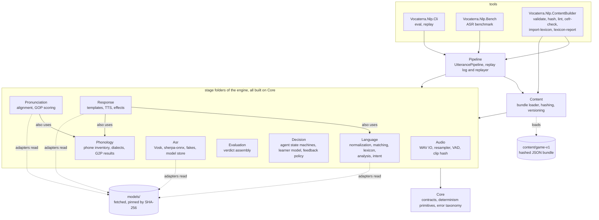

# Architecture of the core

The core's stages and how they depend on each other, how a host uses it, and where its files are. What each stage does with a real
utterance is in [pipeline.md](pipeline.md).

## The stages

The language lives outside the engine: `Vocaterra.Nlp.Es` references `Vocaterra.Nlp` and a host registers it (`SpanishContent.Load`, `LanguagePacks.Default.WithSpanish()`); the engine cannot reference it (ADR 0012).
The dependency direction is `Core` <- stage libraries <- `Content` <- `Pipeline` <- tools, with no cycles; only `Pronunciation` and
`Response` reference a sibling (see [ADR 0003](adr/0003-engine-agnostic-core.md)). For what each stage does with a real
utterance, read [docs/nlp/pipeline.md](pipeline.md).

The same system is also drawn as a one-page draw.io diagram in
[docs/nlp/diagrams/system-overview.drawio](diagrams/system-overview.drawio); [docs/nlp/diagrams/README.md](diagrams/README.md) explains how to open it.

## Using the core from a host

A host calls the core as [docs/nlp/api.md](api.md) lists: load a bundle, build the services, evaluate an utterance, plan a response, replay
a log. The game in this repository (`Vocaterra.Game.Core`, `Vocaterra.Game`, `Vocaterra.Host`) is a host: it references the core's projects directly, so there is no pack step and no feed.
Nothing is published. `ContentBuilder pack <bundleDir> <out.zip>` archives a bundle with a `.sha256` sidecar holding its bundle hash, and
`verify-pack <zip>` checks the archive; hosts ship the extracted folder, since the loader reads a directory.

## Repository layout

| Path | Contents |
| --- | --- |
| `Directory.Build.props` | The repository's build rules: the shared settings, then the groups for the engine `Vocaterra.Nlp` and the projects named `Vocaterra.Nlp.*` (package metadata, packing) and for the game; the pinned SDK (`global.json`) and the package versions (`Directory.Packages.props`) are beside it. `Vocaterra.sln` holds every project; `Vocaterra.Nlp.slnf` is the filter for the core alone |
| `src/Vocaterra.Nlp/Core` | Contracts between stages (`Verdict`, stage records, interfaces), determinism primitives (`SeededRng`, `DeterministicHash`, `CanonicalJson`, `Margin`), error taxonomy |
| `src/Vocaterra.Nlp/Audio` | WAV reading and writing, resampler, downmix, gain, energy VAD, push-to-talk session, clip hash |
| `src/Vocaterra.Nlp/Phonology` | The shared phone inventory, dialect presets, G2P result types, predicted learner-error variants |
| `src/Vocaterra.Nlp.Es` | The Spanish language pack (M53): `SpanishLanguagePack`, normalizer, numbers, phonetic key, morphology, analysis rules, template functions, G2P with `exceptions.json`, the seed lexicon, `SpanishContent` and `SpanishLexicon` for hosts |
| `src/Vocaterra.Nlp/Language` | The language contracts (`ILanguagePack`, the registry), neutral tokenization, answer matching, the lexicon, linguistic analysis, slot grammars, intent resolution, repair strategy |
| `src/Vocaterra.Nlp/Pronunciation` | Phoneme alignment and scoring (greedy edit distance and CTC/GOP), wav2vec2 adapter |
| `src/Vocaterra.Nlp/Asr` | Vosk and sherpa-onnx recognizer adapters, scripted and replay recognizers, model manifest and store |
| `src/Vocaterra.Nlp/Evaluation` | Verdict assembly (pure) and evaluation configuration |
| `src/Vocaterra.Nlp/Decision` | agent state machines, learner model (BKT), FSRS scheduling, feedback policy |
| `src/Vocaterra.Nlp/Response` | Template engine with morphology, recasts, speech synthesis adapters and cache, effect tables |
| `src/Vocaterra.Nlp/Content` | Content bundle schema, loader, validation, hashing |
| `src/Vocaterra.Nlp/Pipeline` | `UtterancePipeline`, `ConversationContext`, replay log and replayer |
| `tools/Vocaterra.Nlp.Cli` | Demo host: `eval` and `replay` |
| `tools/Vocaterra.Nlp.Bench` | ASR benchmark over the golden manifest |
| `tools/Vocaterra.Nlp.ContentBuilder` | `validate`, `hash`, `lint`, `cefr-check`, `import-lexicon`, `lexicon-report` |
| `tests/Vocaterra.Nlp.Tests` | The engine's unit tests, one folder per area, and `Architecture/` (the layering test, ADR 0012) |
| `tests/Shared` | `GameBundleLocator` (finds `content/game-v1` by walking up from the test assembly, so no test project copies the 38 MB bundle) and `TempBundle` (a writable copy of the bundle without the speech clips, for tests that damage or extend it), linked into the Content, Pipeline, Fuzzing and Golden test projects |
| `tests/Vocaterra.Nlp.Es.Tests` | The Spanish pack's unit tests (analysis, lexicon, morphology, normalization, G2P and its golden set `Data/g2p-golden.jsonl`, the pack seams) |
| `tests/Vocaterra.Nlp.Golden.Tests` | End-to-end worked example, golden manifest layout, the Spanish identity guard |
| `tests/Vocaterra.Nlp.Fuzzing.Tests` | Combinatorial fuzz tests: CsCheck oracles over generators driven by the content catalogs ([README](../../tests/Vocaterra.Nlp.Fuzzing.Tests/README.md)) |
| `content/game-v1` | The repository's one content bundle: versioned, hashed JSON, the host files and speech clips of the game, and its `ATTRIBUTION.md` (R02: the core's sample bundle `content/v1` is gone) |
| `tests/golden/` | Golden learner audio manifest and recording protocol; the audio itself is gitignored |
| `models/` | `manifest.json` and a README are committed; the model files are fetched and gitignored |
| `scripts/` | `fetch-models.sh`, `fetch-lexicon-sources.sh`, `license-scan.sh` and its allowlist and overrides ([scripts/README.md](../../scripts/README.md)) |
| `.github/workflows/ci.yml` | CI: the `build-and-test` and `languagetool` jobs, on Linux x64 |
| `docs/nlp/` | [api.md](api.md), [pipeline.md](pipeline.md), [replay.md](replay.md), [lexicon.md](lexicon.md), [cli-examples.md](cli-examples.md) and the architecture decision records in `docs/nlp/adr/` |
| `docs/nlp/diagrams/` | The draw.io system overview and how to open it ([README](diagrams/README.md)) |
| `docs/archive/nlp/history/` | [high-level-docs.md](../archive/nlp/history/high-level-docs.md), the original design note (2026-10-18), kept for history |
| `docs/nlp/implementation-plan.md` | The milestone plan, the findings log and the split roadmap. Host designs, such as the game's, are not in this document |
