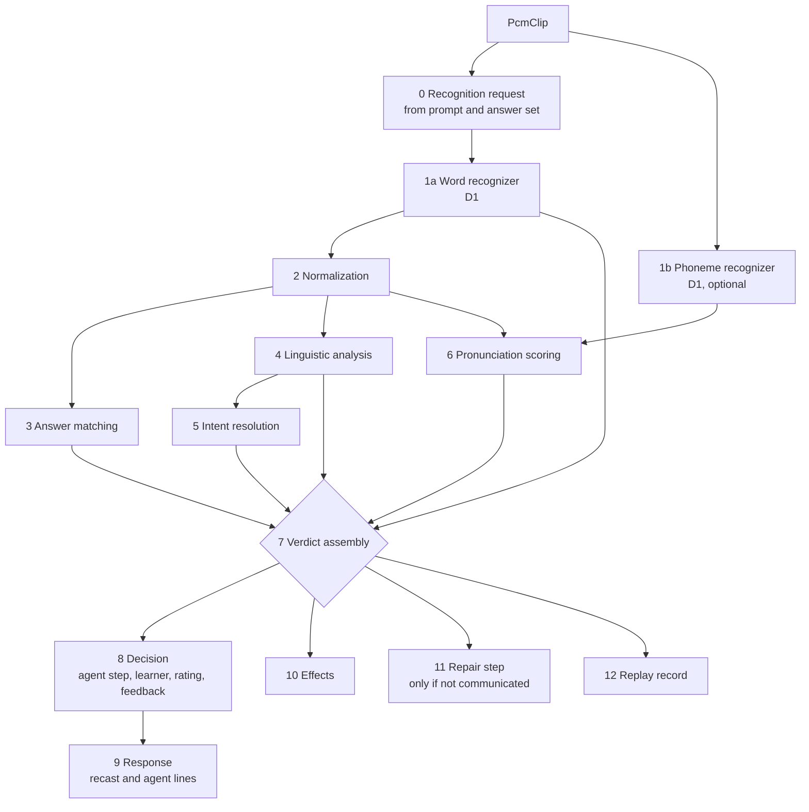

# The utterance pipeline

`Vocaterra.Nlp.Pipeline.UtterancePipeline` turns one recorded utterance into everything the host needs to react: a graded **verdict**, the
agent's and learner model's **decision**, the **lines** the agent says, the **effects**, an optional **repair** step and a
**replay record**. This page walks through `Evaluate` stage by stage, using the worked example from the high-level design
(`docs/archive/nlp/history/high-level-docs.md`, "Verdict contract and error taxonomy"), and shows the actual output of the CLI for it.

- [The call](#the-call)
- [The stages at a glance](#the-stages-at-a-glance)
- [The worked example](#the-worked-example)
- [Stage by stage](#stage-by-stage)
- [The verdict the CLI prints](#the-verdict-the-cli-prints)
- [Other branches](#other-branches)
- [Guarantees](#guarantees)
- [Run it yourself](#run-it-yourself)

## The call

```csharp
var services = new PipelineServices(wordRecognizer, phonemeRecognizer /* or null */, embeddings /* or null */, synthesizer /* or null */, contentBundle);
var pipeline = new UtterancePipeline(services);                       // optional PipelineOptions second argument
PipelineResult result = pipeline.Evaluate(clip, prompt, context);     // or pipeline.Trace(...) to also get the recognizer outputs
```

| Input | Type | What it is |
| --- | --- | --- |
| `clip` | `PcmClip` | 16 kHz mono 16-bit samples plus their SHA-256 `ClipHash`. Produced by `AudioFrontEnd` (resample, downmix, gain, energy VAD) from a push-to-talk capture or a WAV file. |
| `prompt` | `PromptSpec` | What the host asked: prompt id, recognition mode (`Constrained` or `Open`), difficulty, answer set id, allowed intent ids, agent id, slot grammar ids and the optional text (the line the agent says before the answer). Prompts are data (`content/v1/prompts/prompts.json`). |
| `context` | `ConversationContext` | The host state it is evaluated in: world seed, agent id and state, stored time, the learner model, and the repeat counts per error tag before this utterance (empty at the start; the host carries them from the previous `ConversationContext.Next`). Optionally also `HostSlots` (host facts for the reply and feedback templates; the verdict's slot wins on a name clash) and `ExtraSkills` (host-named skills merged with the pipeline's own `intent.<id>` skill in the single learner update); both are per utterance and `Next` does not carry them (api.md section 4). Nothing in it comes from a clock. |

`Evaluate` is `Complete(Analyze(clip, prompt), context)`. A host whose facts depend on the utterance (the nearest sand, once the core has read
`arena`) calls the two phases itself: `Analyze` runs stages 0 to 7 (recognition through verdict assembly, no conversation state) and returns an
immutable `UtteranceAnalysis`; `Complete(analysis, context[, hostSlots, extraSkills])` runs stages 8 to 12. The result is byte-identical to
`Evaluate`, and the recognizers run once (api.md, "Two-phase evaluation"). A host-initiated agent turn without an utterance is
`pipeline.Advance(hostEvent, context)` (api.md, "Host-initiated agent turns"): it runs only the agent step and the reply planning of stages 8 and 9, with
no verdict, learner update or repeat counts.

`PipelineResult` has six members: `Verdict`, `Decision`, `Response`, `Effects`, `Repair` and `Replay`. `Trace` returns a
`PipelineTrace` that adds the word recognizer's `AsrResult` and the phoneme recognizer's `PhonePosteriors`, which is what a
[replay log](replay.md) stores.

Models are optional. Without a phoneme recognizer there is no pronunciation scoring; without an embedding model the third intent
rung is skipped; without a synthesizer only `Synthesize` fails. The word recognizer and the content bundle are required.

## The stages at a glance



| # | Stage | Class | Code | Skipped when |
| --- | --- | --- | --- | --- |
| 0 | Recognition request | D0 | `GrammarBuilder.BuildList` | never |
| 1 | Word recognition; phoneme recognition | D1 | `IWordRecognizer`, `IPhonemeRecognizer` | no phoneme recognizer |
| 2 | Normalization | D0 | `bundle.Language.Normalizer.Normalize` (Spanish: `SpanishTextNormalizer`) | never |
| 3 | Answer matching | D0 | `AnswerMatcher.Match` | never (result `None` if nothing matches) |
| 4 | Linguistic analysis | D0 | `LinguisticAnalyzer.Analyze` | never |
| 5 | Intent resolution | D0, plus one D1 rung | `IntentResolver.Resolve` | the prompt allows no intent (answer-only prompt) |
| 6 | Pronunciation scoring | D1 model, D0 scoring | `PronunciationScorer.Score` | no phoneme recognizer, or no frames |
| 7 | Verdict assembly | D0 | `VerdictAssembler.Assemble` | never |
| 8 | Decision | D0 | `Decide` in `UtterancePipeline.Response.cs` | agent step skipped when the bundle has no state machine for the agent |
| 9 | Response realization | D0 | `ResponsePlanner`, `RecastBuilder` | never (may be empty) |
| 10 | Effects | D0 | `EffectResolver.Resolve` | never (may be empty) |
| 11 | Repair | D0 | `RepairStrategy.Next` | the player was understood |
| 12 | Replay record | D0 | `ReplayRecord` | never |

## The worked example

At the villager of the game's bundle (`content/game-v1`), the player says "yo quiere dos espada" ("I wants two sword": the verb is in the wrong person
and the noun is singular after a number). The high-level design's worked example is "yo tiene dos espada" at a blacksmith; the bundle has no blacksmith and no
open prompt for `tener`, so this is the same shape of sentence in the bundle's words (the design's own sentence runs in the tests, on a prompt built there). The
expectation: intent `request_item`, slots `item=espada, qty=2`, communicated `true`, errors `conj.person` (quiere to quiero) and `noun.number`
(espada to espadas), and a recast from the player's own words, "Claro, «yo quiero dos espadas». Muy bien."

The inputs, as the CLI builds them for `--prompt villager-open` with no other options:

```json
{
  "promptId": "villager-open",
  "mode": "Open",
  "difficulty": "Beginner",
  "answerSetId": "places-basic",
  "allowedIntentIds": ["ask_directions", "request_item", "greet", "thank", "farewell", "ask_help", "dont_know"],
  "agentId": "villager",
  "slotGrammarIds": [],
  "text": "Hola."
}
```

The conversation context is: world seed 0, agent `villager` in state `idle` with interaction counter 0, stored time 0, a fresh learner
model, no repeat counts. The word recognizer is a `ScriptedWordRecognizer` that returns the text given with `--transcript`;
the clip is empty, so there is no phoneme recognizer and no pronunciation scoring.

## Stage by stage

The intermediate values below were printed by running each stage on the example with the repository's `content/game-v1` bundle (the bundle changes with the game, so a number such as a count of phrases may differ after an edit of its content).

### 0. Recognition request

`BuildRequest` looks up the prompt's answer set (an unknown answer set id is an `ArgumentException`) and builds what the word
recognizer is asked to do.

- **Constrained** prompts get a closed phrase list: every canonical answer and alias of the answer set, lower-cased, NFC,
  stripped of punctuation, de-duplicated and ordinal-sorted, followed by `[unk]`. For `stall-need` (the answer set `supplies`):
  `{"mode":"Constrained","grammarPhrases":["agua por favor","ayuda","ayuda por favor","fruta por favor","me ayudas","me da agua","me da agua por favor","me da fruta","me da fruta por favor","me da pan","me da pan por favor","me das agua","me das agua por favor","me das fruta","me das fruta por favor","me das pan","me das pan por favor","me puedes ayudar","necesito agua","necesito agua por favor","necesito ayuda","necesito fruta","necesito fruta por favor","necesito pan","necesito pan por favor","no entiendo","no lo sé","no sé","pan por favor","quiero agua","quiero agua por favor","quiero fruta","quiero fruta por favor","quiero pan","quiero pan por favor","quiero un agua","quiero un pan","quiero una fruta","un agua por favor","un pan por favor","una fruta por favor","yo no sé","[unk]"],"maxAlternatives":5}`.
- **Open** prompts get no phrase list. `villager-open` is open: `{"mode":"Open","grammarPhrases":[],"maxAlternatives":5}`.

### 1. Recognition (D1)

The word recognizer (`IWordRecognizer`: Vosk with the grammar for constrained prompts, Parakeet through sherpa-onnx for open
ones) returns an `AsrResult`: transcript, n-best list, word timings, confidence, model hash and mode. If a phoneme recognizer is
present it runs on a second task at the same time and returns `PhonePosteriors`. Both results are consumed in a fixed order, so
the scheduling cannot change the output (`PipelineOptions.RunRecognizersConcurrently` can turn the concurrency off).

For the example: `{"transcript":"yo quiere dos espada", "nBest":[{"text":"yo quiere dos espada","score":1}], "words":[], "confidence":1, "modelHash":"scripted-transcript", "mode":"Open"}`.

### 2. Normalization (D0)

The transcript loses any `[unk]` markers, then the pack's normalizer (Spanish: `SpanishTextNormalizer.Normalize`, built on the engine's neutral `TextTokenizer`) lower-cases it, applies Unicode NFC, strips punctuation
(keeping `ñ` and accents), and turns number words into digits. The pipeline passes `ConvertIndefiniteArticles = false`:
the normalizer's default would turn `una espada` into `1 espada`, which would hide the article from the agreement checks and the
`[ART]` grammar tokens. Every token keeps its span in the normalized text and its original word.

`yo quiere dos espada` becomes the text `yo quiere 2 espada` with four tokens: `yo` (0, 2), `quiere` (3, 6), `2` (10, 1, original `dos`)
and `espada` (12, 6). The spans in the verdict's errors refer to this normalized text.

### 3. Answer matching (D0)

`AnswerMatcher.Match` compares the normalized text with the prompt's answer set, cheapest first: exact (canonical answers),
alias, then fuzzy (Damerau-Levenshtein on a Spanish phonetic key, with a maximum distance that grows with the phrase length and
the difficulty). A near miss with a distance of 0 on the phonetic key is flagged `likelyPronunciation`: the player knew the word.
The rule for near misses (budget, confidence, communication and the expected word of an unknown word) is in [Near misses](#near-misses).


For the example: `{"answerId":null,"type":"None","distance":13,"likelyPronunciation":false,"confidence":0}`. The sentence is
not one of the three places of `places-basic` on its own, which is expected for a sentence prompt. For an answer such as `piedra` on a prompt whose
answer set is `places-basic` the match is `Exact` with confidence 1.

### Near misses

A near miss is a spelling close to an answer phrase, on any prompt whose answer set can match. One rule decides it (M17c; the
fuzzy stage of `AnswerMatcher` and `AnswerCorrections` implement it, and the fuzz oracle O6 checks it against an independent model):

- **Budget.** The distance `d` is the smaller of the spelling and the phonetic Damerau-Levenshtein distance to a canonical or alias
  phrase. The budget is `floor(length / divisor)`, with the phrase's length in characters after stripping accents and the divisor
  4, 5 or 6 for Beginner, Intermediate and Advanced. The budget is **inclusive**: `d <= budget` is a fuzzy match and `d > budget` is
  not. At Beginner a phrase of 4 to 7 characters allows one edit, so `espado` (one letter off `espada`) is a match on its edge.
- **Confidence.** A fuzzy match has confidence `1 - d/length`, the same at the budget's edge as inside it: one slip in a six-letter
  answer gives 0.83. (Before M17c the edge had a fixed confidence of 0.5, which the communicated margin rejects; that was the bug.)
- **Communication.** A fuzzy match is communicated with `resolvedBy: Fuzzy`, and its confidence is the verdict's confidence (the
  minimum of the stage confidences). With the shipped thresholds (0.6 with epsilon 0.02) no fuzzy match within budget is rejected,
  because its confidence is at least 0.75.
- **Vocabulary.** An unknown word of a near miss (a `vocab.unknown` error) takes the matched answer's word at its place as its
  `expected`, so the recast says the answer. Its spelling is the answer's, with accents and a number in words (`pocion` gives `poción`). A one-word
  input takes the whole canonical phrase (`buenosdias` gives `buenos días`). Otherwise (M70, QA-language-6) the line is aligned word by word with the
  matched answer's phrase nearest it, its canonical phrase or an alias (`AnswerAlignment`), and the unknown word takes the word aligned with it: `una
  ezpada` gives `espada` and the recast reads `una espada`; `compré three manzanas` gives `tres` (before M70 the canonical word nearest its spelling,
  `compré`, and the recast `compré compré manzanas`). An added word, and one whose word stands next to it already, takes none, so a recast never says
  a word twice. Words the lexicon knows are never changed.
- **Inflected forms.** The matcher compares spelled phrases, so an inflection that is a lexicon form (`espadas` for `espada`) is a
  near miss by spelling: it is communicated at confidence 0.83 with no error tag, and `correctness` stays 1. The alternative, an
  `Exact` match with `noun.number`, would need the matcher to read the lexicon, and an answer-only prompt has no grammar to check
  the number with. This is a known limit, to revisit with the analyzer work.

Why `ezpada`, `espado` and `yelo` behaved differently (M17c investigation): a six-letter answer at Beginner has a budget of one edit.
`ezpada` is one letter from `espada`, but the phonetic key maps `z` to `s` (seseo), so its distance is 0 and it is a full-confidence
match. `espado` is one edit from `espada` and `yelo` is one phonetic step from `hielo` (`hielo` keys to `ielo`); both sit exactly on the
budget's edge. The edge was reported with confidence 0.5, which the communicated margin rejected. The budget itself was right; the
fixed confidence at its edge was not.

### 4. Linguistic analysis (D0)

`LinguisticAnalyzer` looks every token up in the lexicon (lemma, part of speech, person, number, tense, mood, gender; an
empty reading list means an unknown word and yields `vocab.unknown`), runs the agreement rules (subject and verb, article and
noun, noun and adjective, quantity and noun, `ser`/`estar`, adjective position, and since M62 a predicate adjective and the copula's subject; since M64 a subject
pronoun joined by `y` to members before it ends a plural subject, `luz y yo fuimos`, and an amount before a singular `ser` is one sum, `dos panes es suficiente`;
since M66 `ni` and `o` join such a subject too, a pronoun right after a finite verb is that verb's subject, a pronoun before a question word is the subject of the
verb after it, the neuter pronouns are singular after a verb of price, and a finite verb after a modal is the slip for the infinitive, `puedo pago`;
[api.md](api.md), "Person and copula errors" and "Tense errors"), and matches the slot grammars. A word the lexicon lacks that is
a learner's slip of a known word is read as that word: a regularized irregular verb form (`quero`) as the verb with `conj.irregular`, and (M58) a plural
made with the wrong ending (`pans`) as the plural noun with `noun.number`; a regularized form that is also a lexicon word (`costa`) gets the verb as a
second reading, which the analysis keeps only where a verb is expected ([api.md](api.md), "Irregular forms, plurals and unknown words"). The grammars
tried are the prompt's own `slotGrammarIds` first, then every other grammar of the allowed intents. Between grammars the one that consumes more
tokens with explicit elements wins; on a tie, the one that binds more tokens to literal words wins (`gracias` beats a bare noun, which the spell
grammar `[NOUN:spell]` would also take, so `gracias` is a thank and not a spell); on a further tie, one that matched the words as the lexicon reads them
beats one that needed a slip's second reading (M58; a grammar is matched over those readings only when it matches nothing without them); and then the
prompt's own grammar, then the first found.

**The slot-grammar DSL.** A grammar is a sequence of these elements, matched against the whole utterance. Every grammar also allows a leading subject pronoun and a trailing `por favor`, both optional.

| Element | Matches | Slot value |
| --- | --- | --- |
| a literal word, `quiero` | a token whose text or lemma is that word, accents ignored | none |
| `[ART]`, `[PRON]`, `[NUM]`, `[NOUN]`, `[ADJ]`, `[ADV]`, `[PREP]`, `[CONJ]`, `[INTERJ]`, `[DET]` | one token with a reading of that part of speech (`[DET]` is an article or a determiner adjective); an optional `:slot` names it | the lemma of that reading (the digits of a numeral) |
| `[VERB]`, `[VERB:lemma]`, `[VERB:lemma:slot]` | one verb form of the lemma, in any person, number or tense | the lemma |
| `[WORD]`, `[WORD:slot]` (M17b) | one token made only of letters (never a number, never punctuation); its lexicon readings do not matter, so a name the lexicon lacks matches | the token as written in the normalized text (lower case, accents kept) |
| `X?` | the element may be absent | none |
| `(a b\|c)` | one of the alternatives, each a sequence; an empty alternative makes the group optional | none |

**Names (`[WORD]`).** A word that the best grammar binds to a `[WORD]` element is a name, and the analyzer treats it as one. It is not reported
as `vocab.unknown` even when the lexicon lacks it, so the analysis keeps its confidence of 1. It carries no reading at all, so a name spelled like
an irregular verb form (`sabo`, the regularized `sé`) is no `conj.irregular` mistake, and a recast does not conjugate a lexicon verb form that is a
name. The reading resolver gives it no word class, so it takes part in no agreement check: `tengo dos espada` with
`tengo [NUM:qty] [WORD:thing]` reports no `noun.number`, and the name breaks the phrases and links around it, as an unknown word does. A word
that the grammar does not bind is an ordinary word again, so an unbound name is reported as unknown, except in the name positions of M78.
The verdict and `AnalysisResult` are unchanged. One limit: a name is one token of letters, so a hyphenated name such as `ana-maría` does not match.

**Name positions (M78).** At a prompt that allows intents (the pipeline, and `TextGrader`; not a quiz, whose misspelt answers are the words they name, and not the
content lint, which flags an example with a word nobody knows), a word with no reading that no grammar binds is also a name in two places: right after the words
that introduce a name (`IAnalysisRules.IsNamePosition`; Spanish: `soy`, `llamo`, `mi nombre es`, `hola`, `buenos días`, `buenas tardes`, `buenas noches`, `buen día`,
`adiós`, `chao`: `soy pedro`, `hola, soy pedro`, `hola pedro`, and `me llamo pedro` at a prompt that does not take `ask_name`), and as the only word of the line when it is capitalised
(`Pedro`; a lone lower-case word, `pedro` or `xyzzy`, cannot be told from a mistyped one, and the game's tests use `xyzzy` as the unknown word, so it stays `vocab.unknown`). It is read as a `[WORD]` name is: no `vocab.unknown`, confidence 1, no reading. Every other unknown word stays unknown (`quiero pedro`, `pedro quiero pan`).
The line's intent is not changed: `Pedro` and `soy pedro` resolve none. A name said to the listener at the end of a line, `necesito ayuda domingo`, is a word of the
lexicon (`domingo`, the day), not an unknown one, and stays flagged by the core (the host takes the NPC's name out of the line first; accepted, M78).

**Which side of an agreement pair is corrected (M29c).** In a noun phrase the generic rule is: an article, numeral or determiner adjective fixes the
number of the noun (`dos espada` gives `noun.number` on `espada`, `las casa` on `casa`), a determiner of the wrong gender is corrected to the noun's gender
(`la río` gives `el`), and an adjective agrees with the noun and the determiner. One exception is a closed table of fixed expressions that are plural as a whole:
`bueno` with `día`, `tarde`, `noche` and `mucho` with `gracia` (`AnalysisTables.IsFixedPluralExpression`). When no other determiner is present and either word is
already plural, the plural is kept, because it is the learner's explicit choice and the lexicalised form, and the singular side is corrected: `mucho gracias` gives
`gender.agree` and `noun.number` on `mucho` with expected `muchas` (the recast is `muchas gracias`, never `mucha gracia`), `buenos día` gives `noun.number`
on `día` with expected `días`, and `buenos noches` gives `gender.agree` on `buenos` with expected `buenas`. A singular expression (`mucha gracia`, `buena noche`) is
ordinary Spanish and keeps the generic checks. A new fixed expression is one more row in the table, with a regression test in
`FixedPluralExpressionTests` and `RecastAgreementModifierTests`.

**One reading per word.** A word the lexicon reads as several parts of speech is resolved to one before the rules run, so that
`libro` (a noun, and a form of `librar`) is not checked as both. `ReadingResolver` does it in three steps, and every rule then runs
on the resolved readings only. The returned tokens still list all readings, because the intent stage matches lemmas on them.

1. **Local syntax** (hard constraints, repeated until nothing changes). After an article, numeral or possessive come further
   determiners and adjectives and then a noun (`un libro`, `dos libro`, `una buena lanza`); an adjective that does not follow a noun
   is prenominal, so a noun follows it (`correcto paseo`); a quantifier that is also an adverb (`mucho`) before a noun is the
   determiner, and so is an adjective-and-adverb word before a noun that cannot be a verb (`temprano pasillo`; `solo agua` is the
   exception, `solo` is an adverb that goes before nouns); the word after a subject pronoun or a clitic (skipping adverbs and
   clitics) is a verb (`yo lanza`, `tú ayudas`), and so is the word after `dónde` or `cómo` when it can be one (`¿dónde son las casas?`,
   M56), past the pronouns before a verb (`¿cómo se llamas?`, M59); a preposition of elapsed time that is also a verb (`hace`) is the
   preposition only before a phrase of time (`hace dos días`) and the verb elsewhere (`¿qué hace?`, M59); the word after a preposition,
   and the complement of `ser`/`estar`, is not a finite verb (`a casa`, `la casa es grande`), except a verb after `ir a` that is nothing
   else but an adverb, a conjunction or a preposition (`voy a como`, `va a hace`, M49 and M59); M62: an adjective that is also a noun (and no finite verb) right
   after the noun of a phrase with a determiner, agreeing with the noun and the determiners, is that noun's adjective (`las manzanas rojas`), a colour that is also a noun right before a
   word that can only be a noun, which it and the determiners before it agree with, is the adjective (`tres rojas manzanas`), the word after `muy`
   or `tan` is no noun (`es muy cara`), and `son` or `era` after the noun of a phrase with a determiner and before an adjective is the copula
   (`las manzanas son caras`); M66: a noun that is also a verb of the third person right after the noun of the phrase that opens the utterance is the verb
   (`las manzanas cuesta`), `son` right after `cuánto` is the copula, and a word right after a modal (`poder`, `querer`, `deber`, `necesitar`, `tener que`) that
   can be a finite verb is the verb where its other readings cannot stand there (`puedo pago`, `quiero vendo madera`, `debo como más fruta`; not `quiero vino`);
   an interjection reading is the last resort (the lexicon lists `sus` and `sé` as
   interjections too). A rule fires on a word only when every reading it has is of the kind that triggers it (an article, not
   the clitic `la`), and only when a reading of its neighbour fits. `ayer`, `anoche` and `anteayer` change nothing here: a word
   after an article is a noun with or without them (`ayer compré un libro`).
2. **Grammar bindings.** When a slot grammar matched the whole utterance, each word was consumed by a grammar element, and the
   words local syntax left open take its reading: `[NOUN:item]` keeps the noun readings, `[VERB:comprar]` the readings of that verb,
   a literal that matched through a lemma (`querer` for `quiero`) the readings of that lemma. A literal spelled like the word
   (`lanza`, `tardes`) constrains nothing, because the author wrote a form and not a reading; a word that tied parses read in
   different ways keeps what any of them accepts. The bindings come after the local rules: a grammar ignores agreement and accepts a
   modifier where a noun is needed, so where the two disagree the neighbouring words win (`yo lanza` matches
   `[VERB:lanzar]? [ART]? [NOUN:spell]` with `lanza` as the noun, and is still a `conj.person` mistake). The grammar is matched first
   for this reason, on all readings; the slots come from that match.
3. **Charitable fallback.** The words that are still ambiguous take the class combination for which the rules report the fewest
   errors (finite verb, infinitive or participle, noun, adjective, determiner, pronoun, adverb, ...). A sentence without any
   finite verb counts as two errors when it has a past-time adverb, so a verb form next to `ayer` is not read as a noun to
   make its tense mistake disappear (`ayer canto una canción`); a sentence of nouns and adjectives with no adverb of the past is not
   charged, because it has no verb and is fine. Ties go to the earlier class in the lexicon's reading order. Up to 256 combinations are tried
   exhaustively; a longer sentence is settled word by word (at most four passes). The two hard steps are what keep this from
   swallowing an injected error, and the mutation oracle O4 of the fuzz suite is the guard.

Not resolved: two verbs that share a form (`fue` is `ir` and `ser`) are one class, and a sentence that is a mistake under one
reading and correct under another, with nothing to prefer either, is read the charitable way (`ayer … intenciones parte`).

Grammar matching works on lemmas and ignores agreement (agreement is what the rules check), and it allows a leading subject
pronoun. So for the example the grammar `[VERB:querer] [ART]? [NUM:qty]? [NOUN:item] (por favor)?` of `request_item` fits `yo quiere 2 espada`, and the analysis is
(readings abbreviated):

```json
{
  "tokens": [
    {"token": {"text": "yo", "span": {"start": 0, "length": 2}, "original": "yo"},
     "readings": [{"lemma": "yo", "pos": "pron", "person": "1", "number": "sg"}]},
    {"token": {"text": "quiere", "span": {"start": 3, "length": 6}, "original": "quiere"},
     "readings": [{"lemma": "querer", "pos": "verb", "person": "2", "number": "sg", "mood": "imp"},
                  {"lemma": "querer", "pos": "verb", "person": "3", "number": "sg", "tense": "pres", "mood": "ind"}]},
    {"token": {"text": "2", "span": {"start": 10, "length": 1}, "original": "dos"},
     "readings": [{"lemma": "2", "pos": "num", "number": "pl"}]},
    {"token": {"text": "espada", "span": {"start": 12, "length": 6}, "original": "espada"},
     "readings": [{"lemma": "espada", "pos": "noun", "number": "sg", "gender": "f"}]}
  ],
  "slots": [
    {"name": "qty", "value": "2", "span": {"start": 10, "length": 1}},
    {"name": "item", "value": "espada", "span": {"start": 12, "length": 6}}
  ],
  "errors": [
    {"tag": "conj.person", "span": {"start": 3, "length": 6}, "expected": "quiero", "actual": "quiere"},
    {"tag": "noun.number", "span": {"start": 12, "length": 6}, "expected": "espadas", "actual": "espada"}
  ],
  "matchedGrammarId": "[VERB:querer] [ART]? [NUM:qty]? [NOUN:item] (por favor)?",
  "confidence": 1
}
```

`yo` is first person, so the third-person `quiere` is a `conj.person` error whose expected form comes from the morphology
generator (`quiero`). The plural quantity `2` makes the singular `espada` a `noun.number` error (`espadas`).

### 5. Intent resolution (D0 plus an optional D1 rung)

`IntentResolver` tries three rungs in a fixed order and stops at the first that is confident: the slot grammar that matched in
stage 4, then lemma keyword rules (lemma `tener` plus an item gives `state_have`), then the embedding nearest neighbour against
the authored example utterances, accepted only if `top1 >= t` and `top1 - top2 >= m` (both with margins). If nothing resolves,
the intent is `unknown` with confidence 0.

**Answer-only prompts skip this stage.** A prompt whose `allowedIntentIds` is empty (a quiz; the game's prompts all allow intents, the tests build one) only asks
for an answer; its answer match is its resolution, and no intent grammar may claim the utterance.

For the example the grammar rung resolves it: `{"intent":"request_item","slots":{"item":"espada","qty":"2"},"rung":"Grammar","margin":1,"confidence":1}`.
The catalog says `request_item` needs the slot `item`, filled; `qty` is an optional element of its grammar.

**The grammar rung reads the whole catalog (M74).** Before the prompt narrows the candidates, the resolver also matches the grammars of the intents the prompt
does not allow. One of them takes the line from the best allowed grammar when it beats it in the rung's order and names more of the line's words (a literal word
or a `[VERB:lemma]`): `hace calor` is `state_weather`'s `hace (…|calor|…):weather`, not the `[NOUN:item]` of a lesson's `[VERB:hacer] [NOUN:item]`. The line is
then unknown at that prompt, with the intent as its off-prompt intent (M72), and it is that intent wherever the prompt allows it. Beating the allowed grammar
without naming more words is not enough: `necesito pan, por favor` stays `state_want` at a lesson (`(por favor)?` of `request_item` reads the same words as the
polite phrase every grammar allows), and `vendo fruta` stays `state_action` (`vendo` names the verb `[VERB:vender]` names). A line no allowed grammar matches goes
down the ladder as before, the allowed keyword rules first: `¿qué tiempo hace?` at `smith-open` is still `ask_activity`'s rule of `qué` with `hacer` until the
prompt allows `ask_weather` (letting the catalog's grammars pre-empt the allowed rules also took `sí, gracias` from `thank` at a thanks lesson). With every intent
allowed the line is read over the whole catalog whatever grammars the analyzer was given.

A leading adverb defeats the grammars: they allow a leading subject pronoun only, so `ayer tengo dos frutas` matches no grammar. The
`state_have` intent therefore has a keyword rule for `tener` that requires `item`. Such an utterance
resolves on the `Rules` rung (`resolvedBy: Rules`), and the analysis still reports the tense (`conj.tense`, `tengo` to `tuve`). An intent without a keyword rule,
such as `request_item`, is not understood after a leading adverb (`ayer quiero dos espadas` on `villager-open` has `communicated: false`, with the tense error
`quiero` to `quise`).

### 6. Pronunciation scoring (D1 model, D0 scoring)

Only when a phoneme recognizer produced frames. The normalized text has its digits spelled out (the G2P drops digits:
`2` becomes `dos`), the pack's G2P (Spanish: `SpanishG2p.PhonemizeAll`) yields the accepted phone sequences for every shipped dialect (ADR 0005), the
predicted English-speaker error variants are generated from them, and `PronunciationScorer` (CTC forced alignment and goodness of
pronunciation by default) scores each phone of the best-matching variant and turns low scores into `pron.*` errors with margins.

In the CLI example there is no phoneme recognizer, so `pronunciation` is `[]`. The end-to-end golden test
(`tests/Vocaterra.Nlp.Golden.Tests/Data/e2e-villager-request.golden.json`) runs the same utterance with a fake phoneme recognizer that
hears the correct phones: the verdict then lists one `PhoneScore` per content phone, each with score 1.

### 7. Verdict assembly (D0)

`VerdictAssembler.Assemble` is a pure function of the earlier outputs, the prompt, the required slots of the resolved intent, the
evaluation configuration and the version stamp:

- **intent** and **slots**: the intent stage's, with the analysis slots underneath (the intent wins a name clash).
- **communicated**: the intent is known, every required slot is filled and the confidence is not rejected by the communicated
  margin; or the answer set matched (exact, alias or fuzzy) with a confidence that is not rejected. An *uncertain* confidence
  counts as communicated: the host rewards being understood. A fuzzy match at the edge of its budget has the confidence of its
  distance, so it is communicated like any other near miss (see [Near misses](#near-misses)).
- **errors**: analysis errors, pronunciation errors and the derived `vocab.wrong`, de-duplicated by (tag, span) and sorted by
  span start, then tag order in the taxonomy, then expected text. The derived `vocab.wrong` (a word the lexicon knows where the answer
  set wanted another) explains a miss by naming a word, at a constrained prompt whose answer set the line did not match, in one of two
  cases (M67, M72, M75):
  - **A near miss** (M75; the owner, 2026-11-02, D-game-22: "a near miss must name its word"): the line resolved no intent, or resolved
    one by a keyword rule or the embedding rung (not a slot grammar), and it misses the answer phrase nearest it (the matcher's distance;
    a canonical phrase or an alias) by one word of a slip pair: the two have the same number of words, exactly one differs (accents
    ignored), and the two words are close in spelling (within the answer word's own fuzzy budget, measured as the matcher measures a
    phrase) or both question words, articles, prepositions or pronouns (`AnswerNearMisses`, `IAnalysisRules.IsQuestionWord`). The tag
    is on that word, with the answer's word as `expected`, so it is never empty: `cuál es esto` at `lesson-what` gives `cuál`, expected
    `qué`. M67's rule (the distance within the fuzzy budget taken for the line's own length) also tagged correct Spanish, which the agent
    praised while it scored 0.4: `quiero hacer un hacha` at `smith-open` (an added word), `pasado mañana iré al río con Mar` and
    `rápido por favor` (content words far apart) have no error since M75. A set with no answers has no near miss (the matcher reports
    distance 0 there, which M67's rule read as a near miss of every line).
  - **A prompt that names its word** (M72): a line that resolved no intent at a prompt whose answer set has exactly one answer, or at a
    quiz (no intent allowed): the tag is on the first content word, with the set's canonical answer as `expected` when it has exactly
    one answer, and an empty `expected` at a quiz of several answers.

  A line a slot grammar understood never gets it, nor does a correct line that is simply not among a prompt's several answers. Its
  `actual` is the word. A `vocab.unknown` of a fuzzy answer match already carries the answer's word at its place. An error on a number
  reports the learner's word for it (M70: `dos`, not `2`).
- **correctness**: 1 minus the sum of the error weights for the prompt's difficulty (`content/game-v1/evaluation/evaluation-config.json`),
  clamped to [0, 1], rounded to 9 decimals. For the beginner difficulty `conj.person` costs 0.25 and `noun.number` 0.15, so
  1 - 0.25 - 0.15 = 0.6.
- **confidence**: the minimum of the stage confidences (recognizer, answer match when something matched, analysis, intent, pronunciation).
- **resolvedBy**: the answer match type when there was one, otherwise the intent rung (`Grammar`, `Rules`, `Embedding`), otherwise `Unresolved`.
- **versions**: the content hash and the model hashes of the services.

### 8. Decision (D0)

`Decide` produces a `DecisionOutcome` with four parts:

1. **agent step.** The agent's state machine (`content/game-v1/agents/villager.json`) reads the verdict and the agent's current state and
   returns the next state and a list of actions (dialogue intent, host event, variant index). The only randomness is the draw for
   the variant, from `SeededRng.ForInteraction(worldSeed, agentId, interactionCounter)`. For the example: `idle` stays `idle`,
   with the action `villager_give` and the host event `villager.give`.
2. **Learner model.** One Bayesian knowledge tracing step per skill: the skill `intent.<intent>` and the family of each error tag
   (`conj`, `noun`), plus any `ExtraSkills` the host named (all in the one update, so a skill named twice or equal to an error family is stepped once). Here `conj` and `noun` drop to a probability known of about 0.146 and `intent.request_item` rises to about 0.693.
3. **FSRS rating.** `RatingMapper.FromVerdict`: not communicated is `Again`; otherwise correctness is compared with the 0.5 and
   0.9 cut-offs (each with a 0.02 margin; an uncertain score rounds down). Correctness 0.6 lies between the two bands, so the
   rating is `Good`.
4. **Feedback plan.** The pipeline first counts this utterance into the context's counts (`RepeatCounts.Next` of the counts before it), then
   `FeedbackPolicy.Plan` gives each error the most specific rule for (tag, repeat count after this utterance, difficulty). The first
   offence of anything is a recast, the second and third a hint, the fourth and later an explicit correction, and any `pron.*`
   error from the second offence on a model pronunciation. At most two items are kept. Here: a recast for `conj.person` and
   a recast for `noun.number`.

**Host events.** The same machine also has host-event transitions (`onHostEvent`), which only `Advance` takes and which an utterance never does. A host
turn runs this stage's step alone: it advances the interaction counter and returns the actions, and the learner, rating and feedback parts do not exist.

### 9. Response realization (D0)

`ResponsePlanner` renders the lines the agent says from the dialogue catalog (`content/game-v1/dialogue/dialogue.json`). The first
feedback item is voiced; for a recast the pool is `feedback.recast.<tag>`, falling back to `feedback.recast`. The
`feedback.recast.conj.person` templates (`Sí: «{verb:conj(1,sg,pres):cap} {qty:words(item)} {item:plural-if(qty)}». ¡Muy bien!` and
`Mira, ¿{verb:conj(2,sg,pres)} {qty:words(item)} {item:plural-if(qty)}? Se dice «{verb:conj(1,sg,pres)} {qty:words(item)} {item:plural-if(qty)}».`) take the player's own slots and inflect
them with the morphology generator: the verb is conjugated and the noun is pluralized according to the
quantity. They need a `verb` slot, which the grammar of `request_item` does not name (`[VERB:tener:verb]` would), so for the example the specific pool cannot render and the
generic pool answers. Generic recast templates use `{recast}`, the corrected sentence that `RecastBuilder` rebuilds from the
player's tokens and the expected forms in the analysis. The recast also restores accents: a word the lexicon knows only once its
accents are ignored takes the lexicon's accented spelling (`dias` becomes `días`, so `buenas dias` is recast as `buenos días`). When
several accented spellings fold alike the first in ordinal order is used. A word that is a lexicon form as spelled is kept, so `se`
stays `se` (it is not `sé`), and `mas` stays `mas`. For the example the draw gives "Claro, «yo quiero dos espadas». Muy bien." with
world seed 0 and "¡Eso es! «Yo quiero dos espadas»." with seed 42. If a feedback template needs a slot the verdict does not have, the pipeline falls back from the
specific pool to the generic pool of the same kind, and then to no feedback, so a content gap never silences the agent.

The agent's own reply comes from the action's pool (`villager_give`), using the variant index drawn in stage 8: "Aquí tienes." with world seed 0
and with seed 42 (the pool's other variant is "Toma.").

A prompt without an agent is not a conversation: nobody replies, only feedback is voiced, except that an acceptable answer to such a
prompt (a quiz) gets a line from the `answer_accepted` pool. (The game's agents use that pool for their own acknowledgements too.)

### 10. Effects (D0)

`EffectResolver.Resolve` looks up the verdict's intent in the effect table (`content/game-v1/effects/effects.json`) and interpolates
a value from the correctness curve: a power, a price factor, whatever opaque kind the host gave it. Partial credit gives a partial effect. The effect table of
the game's bundle is empty (the game derives its effects from its own host files), so `effects` is `[]` here; the tests build a table in the test
(`EffectsFixtureTests`, `TestSupport.EffectsBundle`) to keep the curves covered.

Effects depend on the verdict alone, not on the agent's state: the same verdict emits the same effect in every state of the agent,
so the host gates effects by state (the host decides whether the effect is allowed at that point).

### 11. Repair (D0)

If the player was not understood, `RepairStrategy.Next(attempt, prompt, retryPhrases, choicePhrases, lines)` (the lines are the bundle's pool lines, else the pack's `RepairFallback`) returns the deterministic repair ladder step.
The attempt number is the count of the pseudo-tag `not_communicated` after this utterance (the context's count before it, plus one, so at least 1): attempt 1 is
`AskAgain` ("¿Cómo?"), attempt 2 `SlowRepeat`, attempt 3 `OfferChoices` (one canonical phrase per answer of the answer set, in its declared
order, the first three distinct ones, with a constrained retry request limited to them; see [api.md](api.md#6-plan-the-response-d0-with-d1-for-speech)),
later attempts `GiveUp`. The retry at attempts 1 and 2 uses every phrase the answer set accepts, aliases included. For understood utterances
`repair` is `null`.

### 12. Replay record (D0)

`ReplayRecord(clip.ClipHash, prompt.PromptId, context.HostStateHash, versions, verdict)` is attached to the result. With
`Trace`, the recognizer outputs and the context are what [`docs/nlp/replay.md`](replay.md) calls an envelope.

## The verdict the CLI prints

This is the first line the CLI prints for the worked example, pretty-printed here (the CLI prints it on one line):

```bash
dotnet run --project tools/Vocaterra.Nlp.Cli -- eval --transcript "yo quiere dos espada" --prompt villager-open --content content/game-v1
```

```json
{
  "intent": "request_item",
  "slots": {
    "item": "espada",
    "qty": "2"
  },
  "communicated": true,
  "correctness": 0.6,
  "errors": [
    {
      "tag": "conj.person",
      "span": { "start": 3, "length": 6 },
      "expected": "quiero",
      "actual": "quiere"
    },
    {
      "tag": "noun.number",
      "span": { "start": 12, "length": 6 },
      "expected": "espadas",
      "actual": "espada"
    }
  ],
  "pronunciation": [],
  "confidence": 1,
  "resolvedBy": "Grammar",
  "versions": {
    "contentHash": "<the bundle hash>",
    "modelHashes": {
      "asr": "scripted-transcript"
    }
  }
}
```

After the verdict the CLI prints the agent lines and a decision summary:

```text
agent: Claro, «yo quiero dos espadas». Muy bien.
agent: Aquí tienes.
decision: rating Good, learner skills 3, feedback items 2
```

It matches the high-level design in the bundle's words: an intent, `item=espada`, `qty=2`, communicated, and the two errors with the expected forms
`quiero` and `espadas`. The design's own sentence, "yo tiene dos espada" with `conj.person` (`tiene` to `tengo`) and `noun.number`, is a test
(`TheDesignDocumentsWorkedExampleGivesExactlyConjPersonAndNounNumber` in the pipeline tests), because no prompt of the game answers `tener` openly. Two
details differ from the sketch in the design document, both by design: the recast is one of the seeded variants of the generic pool (the design document's
dedicated template needs a `verb` slot that this grammar does not name), and the agent is the villager of the game, not a blacksmith.

The content hash is the hash of the `content/game-v1` bundle, so it changes with every edit of the game's content. No test pins it: each compares the manifest
with the hash computed from the files (`ManifestTests`), and the end-to-end goldens keep a placeholder instead of the hash.

## Other branches

Each of these is a real run of the CLI on `content/game-v1` (verdict line shortened).

| Command (after `eval`) | Verdict | Printed after the verdict |
| --- | --- | --- |
| `--transcript "quiero agua por favor" --prompt stall-need` | intent `request_item`, slot `item=agua`, communicated, correctness 1, `resolvedBy: Exact` | `agent: Toma la botella. El agua está en el río.`, `agent: ¿Quieres pan?` and `decision: rating Easy, learner skills 1, feedback items 0` |
| `--transcript "hola" --prompt lesson-hello` | intent `greet`, communicated, correctness 1, `resolvedBy: Exact` | `agent: ¡Hola! Soy la guía.` and `decision: rating Easy, learner skills 1, feedback items 0` |
| `--transcript "quiero aguas por favor" --prompt stall-need` | intent `request_item`, `item=agua`, communicated, correctness 1, no errors, `resolvedBy: Fuzzy`, confidence 0.952 (a near miss, an inflected form of the answer; see [Near misses](#near-misses)) | the same two agent lines and `decision: rating Easy, learner skills 1, feedback items 0` |
| `--transcript "ayer tengo dos frutas" --prompt lesson-have` | intent `state_have`, `item=fruta`, communicated, correctness 0.75, `conj.tense` (`tengo` to `tuve`), `resolvedBy: Rules`, confidence 0.9 | `agent: ¡Eso es! «Ayer tuve dos frutas».`, `agent: ¡Muy bien!` and `decision: rating Good, learner skills 2, feedback items 1` |
| `--transcript "bla bla" --prompt villager-open` | intent `unknown`, not communicated, correctness 0.2, two `vocab.unknown` errors, `resolvedBy: Unresolved`, confidence 0 | `agent: No te entendí. ¿Me lo dices otra vez?`, `repair: AskAgain ¿Cómo?`, `decision: rating Again, learner skills 1, feedback items 1` |
| the same with `--repeat not_communicated=1` (the second failure) | as above | `repair: SlowRepeat Perdón, te lo repito más despacio.` |
| the same with `--repeat not_communicated=2` (the third failure) | as above | `repair: OfferChoices ¿Quieres decir «árbol», «piedra» o «río»?` |

The first rows show a constrained prompt: the answer set matched, and the intent grammar reads the same words. The fourth shows what the same prompt makes of a
sentence that is not one of its phrases: the intent is found by the keyword rule, and the tense is still checked. Before M67 the first word outside the answer
set was also `vocab.wrong` (`ayer`, correctness 0.15); the sentence was understood and is far from every phrase, so it has no miss for the tag to explain.

## Guarantees

- **Fixed order.** The stages run in the order above. Word and phoneme recognition may run on two tasks, but their results are
  consumed in a fixed order and no stage shares mutable state with another.
- **Pure after recognition.** Everything from stage 2 on is a function of the recognizer outputs, the prompt, the context and the
  content bundle. The only randomness is the seeded draw in stages 8 and 9, seeded from the context.
- **Same inputs, same bytes.** Two evaluations with the same clip, prompt, context and services give results whose
  `CanonicalJson` is identical; `UtterancePipeline` keeps no state between utterances, so one instance can serve many.
- **Replayable.** The recognizer outputs plus the context are enough to reproduce the result without the models. A host turn needs only the context.
- **Two phases equal one.** `Complete(Analyze(clip, prompt), context)` and `Evaluate(clip, prompt, context)` are the same computation (the fuzz suite compares
  them across two pipeline instances, with the host facts given to phase 2).
- **Margins, not knife edges.** Intent acceptance, communication, pronunciation and the FSRS rating all use `Margin` bands with
  an explicit uncertain branch (ADR 0002).

## Run it yourself

```bash
dotnet run --project tools/Vocaterra.Nlp.Cli -- eval --transcript "yo quiere dos espada" --prompt villager-open --content content/game-v1
```

Add `--seed <n>` (world seed), `--now <unixSeconds>`, `--agent-state <id>` (start the agent in a given state), `--counter <n>`
(interaction counter), `--repeat <tag>=<n>` (repeat counts before this utterance) and `--replay-out <file>` to control the conversation context and record the
run. `dotnet run --project tools/Vocaterra.Nlp.Cli -- --help` prints the full usage. The prompt ids of the bundle are listed in
`content/game-v1/prompts/prompts.json`.
