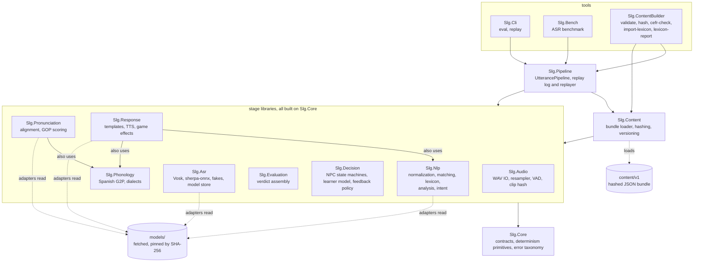

# Spanish Learning Game

A Terraria-style exploration and progression game in which learners practise Spanish by speaking to NPCs; this repository holds the deterministic voice recognition, decision, and feedback system written in C# on .NET.

The game hears the player speak, works out what they meant and how well they said it, and reacts in the world: casting a spell, trading with the blacksmith, answering a quiz. Every utterance becomes one **verdict** that separates whether the player *communicated* (the NPC understood) from whether they were *correct* (grammar, vocabulary, pronunciation), with tagged errors such as `conj.person` or `pron.r`. The guiding principle is to reward communication and coach correctness: if the player was understood the world responds, and the correction rides along on the response, for example as a recast ("¿Tienes dos espadas?").

**Every runtime step is deterministic.** The same audio clip, game state and content version always produce the same verdict, feedback and game outcome. Algorithmic stages are plain code with fixed-order math; the neural models (speech recognition, phoneme recognition, embeddings, speech synthesis) are frozen, run greedily on one CPU thread, and are pinned by SHA-256, with a margin on every threshold so floating-point drift cannot flip an outcome. Every graded interaction can be written to a replay log and re-checked later without the models. The libraries are engine-agnostic; the game engine is not chosen yet.

## Architecture



The dependency direction is `Core` <- stage libraries <- `Content` <- `Pipeline` <- tools, with no cycles; only `Pronunciation` and
`Response` reference a sibling (see [ADR 0003](docs/adr/0003-engine-agnostic-core.md)). For what each stage does with a real
utterance, read [docs/PIPELINE.md](docs/PIPELINE.md).

The same system is also drawn as a one-page draw.io diagram in
[docs/diagrams/system-overview.drawio](docs/diagrams/system-overview.drawio); [docs/diagrams/README.md](docs/diagrams/README.md) explains how to open it.

## Prerequisites

- **.NET SDK 10.0.402**, pinned in `global.json` (`rollForward: latestPatch` allows later patch releases). Projects target `net10.0`.
- A user-local install is enough; no administrator rights are needed:

  ```bash
  curl -sSL https://dot.net/v1/dotnet-install.sh -o dotnet-install.sh
  bash dotnet-install.sh --version 10.0.402 --install-dir "$HOME/.dotnet"
  export DOTNET_ROOT="$HOME/.dotnet"
  export PATH="$HOME/.dotnet:$PATH"
  ```

  Put the two `export` lines in your shell profile, or run them at the start of every shell. `dotnet --version` inside the
  repository should print `10.0.402`.
- On Linux the ICU libraries (`libicu`) must be installed: invariant globalization is deliberately off ([ADR 0006](docs/adr/0006-globalization-icu.md)).
- To fetch models: `bash`, `python3`, `curl`, `sha256sum` (or `shasum`), and `unzip` or `tar` with bzip2.
- A full build writes roughly 3 GB of `bin/` and `obj/` output because of the native speech packages. Make room, and delete
  the output with `git clean -fdX -- src tests tools` when you are done with a checkout.

## Build, test, format

```bash
dotnet restore
dotnet build -warnaserror
dotnet test
dotnet format                       # apply the formatting rules
dotnet format --verify-no-changes   # what CI checks
```

Tests that need a real model are skipped, not failed, unless `SLG_MODELS_DIR` points at a directory holding the verified model
(see below).

### Fuzz tests

`tests/Slg.Fuzzing.Tests` generates inputs from the lexicon, the intent grammars and `content/v1`, and checks sixteen oracles against the
real stages. It needs no model, and it runs at full depth as part of the normal test run:

```bash
dotnet test tests/Slg.Fuzzing.Tests
```

To soak it, raise the iteration count of the oracle groups with environment variables. The `fuzz-soak` job in the CI workflow runs the
same settings weekly; that workflow is parked (see Known gaps):

```bash
SLGFUZZ_ITERATIONS=50000 SLGFUZZ_ITERATIONS_GRAMMAR=50000 SLGFUZZ_ITERATIONS_SIGNAL=10000 \
SLGFUZZ_ITERATIONS_PIPELINE=3000 SLGFUZZ_ITERATIONS_CONTENT=5000 dotnet test tests/Slg.Fuzzing.Tests
```

A failing run prints a CsCheck seed. Replay that exact case with the same project:

```bash
CsCheck_Seed=<seed> dotnet test tests/Slg.Fuzzing.Tests
```

The failure message also carries the generated input, which is what a regression test needs. The design is in
[docs/FUZZING_PLAN.md](docs/FUZZING_PLAN.md); the oracles, the bounds and the bugs found so far are in
[tests/Slg.Fuzzing.Tests/README.md](tests/Slg.Fuzzing.Tests/README.md).

## Running the demo CLI

`tools/Slg.Cli` runs one utterance through the whole pipeline and prints the verdict, the NPC's lines, game effects and the repair step.

### Without models: `--transcript`

Without `--models` the word recognizer is scripted from the text you give it, so no model and no audio are needed. This is the
worked example from the design: at the blacksmith, the player says "yo tiene dos espada".

```bash
dotnet run --project tools/Slg.Cli -- eval --transcript "yo tiene dos espada" --prompt offer-items-open --content content/v1
```

```text
{"intent":"offer_item","slots":{"item":"espada","qty":"2","verb":"tener"},"communicated":true,"correctness":0.5,"errors":[{"tag":"conj.person","span":{"start":3,"length":5},"expected":"tengo","actual":"tiene"},{"tag":"noun.number","span":{"start":11,"length":6},"expected":"espadas","actual":"espada"}],"pronunciation":[],"confidence":1,"resolvedBy":"Grammar","versions":{"contentHash":"8090fe859f5ad0f7eeec56d1aa710110b00a8de76deca8728887d21826bafb78","modelHashes":{"asr":"scripted-transcript"}}}
npc: Ah, ¿tienes dos espadas? ¡Muy bien!
npc: Vale, dos espadas. Gracias, amigo.
decision: rating Hard, learner skills 3, feedback items 2
```

The first line is the verdict (the player was understood, and two grammar errors are tagged with the corrected forms); the rest is
what the game does with it. [docs/PIPELINE.md](docs/PIPELINE.md) explains every part.

Other prompts to try (the sample bundle has 14, listed in `content/v1/prompts/prompts.json`):

```bash
dotnet run --project tools/Slg.Cli -- eval --transcript "espada" --prompt quiz-item-name --content content/v1
dotnet run --project tools/Slg.Cli -- eval --transcript "fuego" --prompt spell-cast-constrained --content content/v1
dotnet run --project tools/Slg.Cli -- eval --transcript "bla bla" --prompt offer-items-open --content content/v1 --repeat not_communicated=2
```

The game context can be set from the command line: `--seed <n>` (world seed), `--now <unixSeconds>`, `--npc-state <id>`, `--counter <n>`
(interaction counter) and `--repeat <tag>=<n>` (how often an error was repeated). `dotnet run --project tools/Slg.Cli -- --help` prints the
usage. Exit codes: 0 success, 1 failed evaluation or a replay that differs, 2 a malformed command line.

### With models: `--wav`

Real recognition needs a model and a recording. The small Spanish Vosk model is enough for constrained prompts (spells, item
names, quizzes):

```bash
scripts/fetch-models.sh --list                              # which models are present, missing or mismatching
scripts/fetch-models.sh vosk-model-small-es-0.42            # download, verify the SHA-256 of the archive and of every file
export SLG_MODELS_DIR="$PWD/models"                         # where the tests and tools look for models
dotnet run --project tools/Slg.Cli -- eval --wav clip.wav --prompt spell-cast-constrained --content content/v1 --models models
```

`clip.wav` is any WAV file (16-bit PCM or 32-bit float, mono or stereo, any sample rate; the audio front end converts it to 16 kHz mono). Models are
downloaded, never committed; `models/manifest.json` pins every file, and [models/README.md](models/README.md) describes the manifest.
`--models` needs `--wav`. The CLI picks Vosk for constrained prompts; for open prompts it uses Parakeet when
`sherpa-onnx-nemo-parakeet-tdt-0.6b-v3-int8` is present in the models directory and falls back to Vosk otherwise; it adds
pronunciation scoring when `wav2vec2-xlsr-53-espeak-cv-ft` is present. The last two do not have an ONNX export in the repository yet
(see Known gaps). With `SLG_MODELS_DIR` set, `dotnet test` also runs the model-gated tests.

### More examples

These are real runs against `content/v1`. Each verdict is abbreviated: `…` marks the cut fields (`pronunciation`, `confidence`,
`resolvedBy` and `versions`, unless an example keeps them), and the closing `decision:` line is left out. Error spans count characters of the
normalized text. Twelve more examples are in [docs/CLI_EXAMPLES.md](docs/CLI_EXAMPLES.md): the other four intents, five more
error tags, an exact quiz answer, the repair ladder and a replay log.

A correct utterance is understood in full: the slots are filled, there are no errors and the trade price factor is 1.

```bash
dotnet run --project tools/Slg.Cli -- eval --transcript "quiero comprar dos pociones" --prompt buy-item-open --content content/v1
```

```text
{"intent":"buy_item","slots":{"item":"poción","qty":"2"},"communicated":true,"correctness":1,"errors":[],…}
npc: La poción es una buena elección.
effect: buy_item_price trade_price 1
```

A slip does not stop the trade. `un espada` is a `gender.agree` error, so the NPC recasts the sentence correctly and the price factor
rises to 1.045, because the curve in `content/v1/effects/effects.json` runs from 1.3 at correctness 0 to 1 at correctness 1:

```bash
dotnet run --project tools/Slg.Cli -- eval --transcript "quiero comprar un espada" --prompt buy-item-open --content content/v1
```

```text
{"intent":"buy_item","slots":{"item":"espada"},"communicated":true,"correctness":0.85,
 "errors":[{"tag":"gender.agree","span":{"start":15,"length":2},"expected":"una","actual":"un"}],…}
npc: Ah, quiero comprar una espada. ¡Perfecto!
npc: La espada es una buena elección.
effect: buy_item_price trade_price 1.045
```

An answer-only quiz prompt has no intent (its `allowedIntentIds` is empty), so the answer set decides. A near miss still counts when the
fuzzy match is close: "fuegos" for "fuego" is accepted, and `resolvedBy` and `confidence` show how:

```bash
dotnet run --project tools/Slg.Cli -- eval --transcript "una bola de fuegos" --prompt quiz-spell-name --content content/v1
```

```text
{"intent":"unknown","slots":{},"communicated":true,"correctness":1,"errors":[],"confidence":0.9411764705882353,"resolvedBy":"Fuzzy",…}
npc: ¡Muy bien!
```

A word the lexicon does not know is a `vocab.unknown` error, and when no intent can be resolved the player is not understood. The NPC
asks again, and the first repair step is `AskAgain`:

```bash
dotnet run --project tools/Slg.Cli -- eval --transcript "quiero comprar una zanahoria" --prompt buy-item-open --content content/v1
```

```text
{"intent":"unknown","slots":{},"communicated":false,"correctness":0.6,
 "errors":[{"tag":"vocab.unknown","span":{"start":19,"length":9},"expected":"","actual":"zanahoria"}],…}
npc: Perdón, ¿qué dices?
repair: AskAgain ¿Cómo?
```

`--repeat <tag>=<n>` says how many times in a row the learner has made that error, counting this utterance. A game keeps that count
between utterances; the CLI takes it from the command line. The feedback policy (`content/v1/feedback/feedback-policy.json`) answers
the first offence with a recast, the second and third with a hint and the fourth and later with an explicit correction. The same
`un espada`, as the second and as the fourth offence:

```bash
dotnet run --project tools/Slg.Cli -- eval --transcript "quiero comprar un espada" --prompt buy-item-open --content content/v1 --repeat gender.agree=2
```

```text
{"intent":"buy_item","slots":{"item":"espada"},"communicated":true,"correctness":0.85,
 "errors":[{"tag":"gender.agree","span":{"start":15,"length":2},"expected":"una","actual":"un"}],…}
npc: La espada es una buena elección.
npc: Piensa en el género: ¿un?
effect: buy_item_price trade_price 1.045
```

```bash
dotnet run --project tools/Slg.Cli -- eval --transcript "quiero comprar un espada" --prompt buy-item-open --content content/v1 --repeat gender.agree=4
```

```text
{"intent":"buy_item","slots":{"item":"espada"},"communicated":true,"correctness":0.85,
 "errors":[{"tag":"gender.agree","span":{"start":15,"length":2},"expected":"una","actual":"un"}],…}
npc: La espada es una buena elección.
npc: Mejor así: «una».
effect: buy_item_price trade_price 1.045
```

`--npc-state <id>` starts the NPC in another state of its machine (the blacksmith in `content/v1/npcs/blacksmith.json` has `idle`, the
default, `trading` and `done`; an unknown id is an error). The open `trade-free-conversation` prompt accepts any of the four trade
intents. In the default state the blacksmith answers a purchase like this:

```bash
dotnet run --project tools/Slg.Cli -- eval --transcript "quiero comprar dos pociones" --prompt trade-free-conversation --content content/v1
```

```text
{"intent":"buy_item","slots":{"item":"poción","qty":"2"},"communicated":true,"correctness":1,"errors":[],…}
npc: La poción es una buena elección.
effect: buy_item_price trade_price 1
```

Once the trade is `done` the same sentence is understood just as well, but the NPC is already saying goodbye. The effect line does not
change, because effects depend only on the verdict:

```bash
dotnet run --project tools/Slg.Cli -- eval --transcript "quiero comprar dos pociones" --prompt trade-free-conversation --content content/v1 --npc-state done
```

```text
{"intent":"buy_item","slots":{"item":"poción","qty":"2"},"communicated":true,"correctness":1,"errors":[],…}
npc: Gracias por venir. ¡Vuelve pronto!
effect: buy_item_price trade_price 1
```

`--seed <n>` is the world seed. Together with the NPC id and `--counter` (the interaction counter) it seeds the draw that picks one of the
NPC's variant lines, so the same inputs always give the same line and another seed can give another one. The `greet_reply` pool has
three variants; the default seed 0 says "¡Hola, amigo! ¿Qué necesitas hoy?", and seeds 2 and 42 pick the other two (running seed 42 again
prints the identical line):

```bash
dotnet run --project tools/Slg.Cli -- eval --transcript "hola" --prompt greet-blacksmith --content content/v1 --seed 2
```

```text
{"intent":"greet","slots":{},"communicated":true,"correctness":1,"errors":[],…}
npc: Buenos días. ¿En qué puedo ayudarte?
```

```bash
dotnet run --project tools/Slg.Cli -- eval --transcript "hola" --prompt greet-blacksmith --content content/v1 --seed 42
```

```text
{"intent":"greet","slots":{},"communicated":true,"correctness":1,"errors":[],…}
npc: ¡Bienvenido a la herrería!
```

With the Vosk model fetched, `--wav` runs the same pipeline on audio. Here `fuego.wav` is the word "fuego" synthesized with the
Spanish voice of espeak-ng for this example; any recording of the word works. The constrained spell prompt recognizes it. The verdict now
carries the recognizer's own confidence, and `versions.modelHashes.asr` holds the SHA-256 of the Vosk model instead of `scripted-transcript`:

```bash
dotnet run --project tools/Slg.Cli -- eval --wav fuego.wav --prompt spell-cast-constrained --content content/v1 --models models
```

```text
{"intent":"cast_spell","slots":{"spell":"fuego"},"communicated":true,"correctness":1,"errors":[],"confidence":0.6071389421064182,"resolvedBy":"Exact",…}
npc: ¡Muy bien!
effect: cast_spell_power spell_power 1
```

The pronunciation tags (`pron.*`) need the phoneme model, which has no ONNX export in the repository yet, so none of these commands can trigger them.

## Replay logs

`--replay-out <file>` appends one JSON line per utterance with everything needed to re-evaluate it without models or audio:

```bash
dotnet run --project tools/Slg.Cli -- eval --transcript "yo tiene dos espada" --prompt offer-items-open --content content/v1 --replay-out replay.jsonl
dotnet run --project tools/Slg.Cli -- replay replay.jsonl --content content/v1
```

The second command prints `OK`, or the JSON paths that differ (for example `DIFF entry 1: /verdict/correctness`) and exits 1.
Audio is never stored and logs are opt-in. The format, a real example and what a difference means are in [docs/REPLAY.md](docs/REPLAY.md).

## Content builder

Content (answer sets, intents, prompts, NPCs, dialogue, lexicon, evaluation weights, effects) lives in `content/v1` as a hashed
bundle. `tools/Slg.ContentBuilder` is the build-time tool:

```bash
dotnet run --project tools/Slg.ContentBuilder -- validate content/v1                      # verify hashes and cross-references
dotnet run --project tools/Slg.ContentBuilder -- hash content/v1                          # rewrite content/v1/manifest.json after an edit
dotnet run --project tools/Slg.ContentBuilder -- cefr-check content/v1 --level a1         # list dialogue lemmas missing from the CEFR list (a1 or a2)
dotnet run --project tools/Slg.ContentBuilder -- import-lexicon kaikki.jsonl lexicon.json # wiktextract Spanish JSONL to a lexicon file (--max N limits it;
#   --frequency es_50k.txt --top N keeps the N most frequent lemmas; --sidecar writes the source record; see docs/LEXICON.md)
dotnet run --project tools/Slg.ContentBuilder -- lexicon-report content/v1                # each lexicon file, how they overlap, the merged lexicon
```

Any edit to a file in `content/v1` changes the bundle hash, so run `hash` afterwards and update the pinned value in the tests
(see [CONTRIBUTING.md](CONTRIBUTING.md)). `validate` prints `OK: bundle 'v1' 1.0.0, 19 files, hash <sha256>`.

## Benchmark and golden audio

`tools/Slg.Bench` runs a recognizer over the golden learner manifest and reports word error rate, learner-error preservation (does the
transcript keep the mistake the learner made?) and latency:

```bash
dotnet run --project tools/Slg.Bench -- --manifest golden/manifest.jsonl --content content/v1 --models models
```

The three committed entries are synthetic, so the clips are reported as `missing-clip` on a plain checkout. The recording protocol,
consent rules and manifest schema are in [golden/README.md](golden/README.md).

## Repository layout

| Path | Contents |
| --- | --- |
| `global.json`, `Directory.Build.props`, `Directory.Packages.props` | Pinned SDK, shared build rules, the only place package versions live |
| `src/Slg.Core` | Contracts between stages (`Verdict`, stage records, interfaces), determinism primitives (`SeededRng`, `DeterministicHash`, `CanonicalJson`, `Margin`), error taxonomy |
| `src/Slg.Audio` | WAV reading and writing, resampler, downmix, gain, energy VAD, push-to-talk session, clip hash |
| `src/Slg.Phonology` | Spanish grapheme-to-phoneme converter, dialect presets, predicted learner-error variants |
| `src/Slg.Nlp` | Text normalization, answer matching, lexicon and morphology, linguistic analysis, slot grammars, intent resolution, repair strategy |
| `src/Slg.Pronunciation` | Phoneme alignment and scoring (greedy edit distance and CTC/GOP), wav2vec2 adapter |
| `src/Slg.Asr` | Vosk and sherpa-onnx recognizer adapters, scripted and replay recognizers, model manifest and store |
| `src/Slg.Evaluation` | Verdict assembly (pure) and evaluation configuration |
| `src/Slg.Decision` | NPC state machines, learner model (BKT), FSRS scheduling, feedback policy |
| `src/Slg.Response` | Template engine with morphology, recasts, speech synthesis adapters and cache, game-effect tables |
| `src/Slg.Content` | Content bundle schema, loader, validation, hashing |
| `src/Slg.Pipeline` | `UtterancePipeline`, `GameContext`, replay log and replayer |
| `tools/Slg.Cli` | Demo host: `eval` and `replay` |
| `tools/Slg.Bench` | ASR benchmark over the golden manifest |
| `tools/Slg.ContentBuilder` | `validate`, `hash`, `cefr-check`, `import-lexicon`, `lexicon-report` |
| `tests/Slg.<Project>.Tests` | One xUnit project per source project |
| `tests/Slg.Golden.Tests` | G2P golden set, end-to-end worked example, golden manifest layout |
| `tests/Slg.Fuzzing.Tests` | Combinatorial fuzz tests: CsCheck oracles over generators driven by the content catalogs ([README](tests/Slg.Fuzzing.Tests/README.md)) |
| `content/v1` | The versioned, hashed content bundle (JSON) and its `ATTRIBUTION.md` |
| `golden/` | Golden learner audio manifest and recording protocol; the audio itself is gitignored |
| `models/` | `manifest.json` and a README are committed; the model files are fetched and gitignored |
| `scripts/` | `fetch-models.sh`, `fetch-lexicon-sources.sh`, `license-scan.sh` and its allowlist and overrides ([scripts/README.md](scripts/README.md)) |
| `.github/workflows-pending/` | The CI workflow, parked until the push token has the `workflow` scope |
| `docs/` | [PIPELINE.md](docs/PIPELINE.md), [REPLAY.md](docs/REPLAY.md), [LEXICON.md](docs/LEXICON.md), [CLI_EXAMPLES.md](docs/CLI_EXAMPLES.md) and the architecture decision records in `docs/adr/` |
| `docs/diagrams/` | The draw.io system overview and how to open it ([README](docs/diagrams/README.md)) |
| `HIGH_LEVEL_DOCS.md`, `IMPLEMENTATION_PLAN.md`, `SPECIFICATION.md` | The design, the milestone plan and the original brief |

## Determinism rules in brief

The full rules, with where each is enforced, are in [ADR 0002](docs/adr/0002-determinism-rules.md); the pull request checklist is in
[CONTRIBUTING.md](CONTRIBUTING.md). In short, code under `src/` must:

- use no `System.Random` (only `SeededRng.ForInteraction(worldSeed, npcId, counter)`) and no wall clock (time arrives as a `StoredTimestamp`);
- hash with `DeterministicHash` (SHA-256) only, and never let `Dictionary` or `HashSet` order reach any output;
- compare ordinally, use the invariant culture and Unicode NFC everywhere;
- put a `Margin` on every threshold and handle all three outcomes (accept, reject, uncertain);
- keep models behind `Slg.Core` interfaces, run them on one thread on the CPU, and gate real-model tests on `SLG_MODELS_DIR`;
- contain no LLM or other non-deterministic code, and pin every model and content version by hash.

## Licensing

This repository does not have a license file yet; choosing one is up to the repository owner. What is known about the
dependencies and data:

- **Code dependencies** are checked by `scripts/license-scan.sh [--offline]`, which reads every NuGet package (direct and
  transitive) of the solution and fails on GPL, LGPL, AGPL and SSPL or on any license that is not in `scripts/license-allowlist.txt`.
  `scripts/license-overrides.txt` holds reviewed exceptions for packages whose metadata names no license. Today 27 packages pass.
- **Wiktionary-derived data** (`content/v1/lexicon/wiktionary-es.json`, made with `import-lexicon` and selected with a word frequency list) is
  CC BY-SA and must keep its attribution; the sample bundle's other files are hand-authored. See
  [content/v1/ATTRIBUTION.md](content/v1/ATTRIBUTION.md) and [docs/LEXICON.md](docs/LEXICON.md).
- **Models** and their licenses are recorded in [models/manifest.json](models/manifest.json): Vosk small Spanish (Apache-2.0),
  Parakeet TDT 0.6B v3 (CC-BY-4.0, attribution to NVIDIA required), wav2vec2-xlsr-53-espeak-cv-ft (Apache-2.0),
  multilingual-e5-small (MIT), Kokoro (Apache-2.0).
- **Two GPL components must stay out of anything shipped**: espeak-ng (GPL-3.0) and the current Piper runtime. espeak-ng is
  only a development-time oracle. Kokoro's bundled phonemizer is espeak-ng, and the sherpa-onnx native library appears to
  contain it too; see [ADR 0007](docs/adr/0007-kokoro-phonemizer-licensing.md) and Known gaps. This is an engineering note, not legal advice.

## Status

Milestones from `IMPLEMENTATION_PLAN.md`:

| ID | Milestone | Status |
| --- | --- | --- |
| M0 | Solution scaffold: SDK pin, props, all project stubs, CI skeleton | done |
| M1 | Core contracts + determinism primitives + taxonomy | done |
| M2 | Audio front-end (WAV IO, resample, gain, energy VAD, clip hash, push-to-talk session) | done |
| M3 | Spanish G2P with dialect config, alignment, predicted-error variants, golden set | done |
| M4 | Text normalization + answer matching (exact/alias/fuzzy + phonetic key) | done |
| M5 | Lexicon schema + seed lexicon + morphology generator + linguistic analysis + slot grammar | done |
| M7 | Verdict assembly (pure D0) incl. worked example | done |
| M10 | Decision layer: NPC state machine, learner model (BKT + FSRS), feedback policy | done |
| M6 | Intent resolution (grammar, rules, embedding with margins) + repair strategy | done |
| M8 | Pronunciation scoring: v1 greedy+edit distance, v2 CTC Viterbi + GOP, wav2vec2 adapter | done |
| M9 | ASR adapters: Vosk constrained, sherpa-onnx Parakeet open, fakes, model manifest + fetch script | done |
| M11 | Response realization: templates + morphology, recasts, TTS adapters + cache, effect tables | done |
| M12 | Content bundle: schema, loader, hashing, ContentBuilder CLI (kaikki import), sample content v1 | done |
| M13 | Pipeline orchestration, replay log + replayer, CLI demo, bench harness, golden layout | done |
| M13b | Integration fixes from the demo: answer-match communication, spell grammars, blacksmith idle transitions | done |
| M14 | CI matrix (x64/ARM64/Windows/macOS), golden tests, license scan, format check (workflow parked in `.github/workflows-pending`) | done |
| M15 | README, ADRs, CONTRIBUTING, determinism checklist, replay and pipeline docs | done |
| M16 | Combinatorial fuzz testing: CsCheck, 16 oracles over catalog-driven generators | done |
| M17a | Vocabulary: 3 000 Wiktionary lemmas (about 40 000 entries) selected by a frequency list, with sources, hashes and coverage tests (see [docs/LEXICON.md](docs/LEXICON.md)) | done |

## Known gaps and next steps

- **Engine integration.** Nothing in this repository is a game yet. A host still has to capture the microphone (v1 has no
  operating-system capture adapter, only WAV files and `PushToTalkSession`), play the synthesized audio, map saves to `GameContext`
  and back, apply `GameEffect`s and NPC game events, and ship the native speech libraries. The engine is not chosen
  ([ADR 0003](docs/adr/0003-engine-agnostic-core.md)).
- **Real golden learner audio.** `golden/manifest.jsonl` has three synthetic entries and `golden/audio/` is empty. Until
  recordings of real non-native speakers exist, word error rate, learner-error preservation, the pronunciation thresholds
  (initial, uncalibrated guesses) and the latency budget of the design document are unmeasured.
- **ONNX exports for wav2vec2 and e5.** The upstream wav2vec2 phoneme model ships PyTorch weights only and multilingual-e5-small
  needs its ONNX file copied in; neither is pinned in `models/manifest.json`. Until they are, pronunciation scoring and the
  embedding rung of intent resolution run only with fakes in tests. The embedding tokenizer is unverified against the real
  e5 files. The Parakeet and Kokoro file hashes are pending their first fetch.
- **Kokoro phonemizer licensing.** Kokoro through sherpa-onnx phonemizes with espeak-ng (GPL-3.0), and the sherpa-onnx native
  library appears to link it statically. The plan is to feed Kokoro phones from the in-house G2P and to settle the native
  binaries before release ([ADR 0007](docs/adr/0007-kokoro-phonemizer-licensing.md)). Dynamic TTS must not ship until then.
- **App-local ICU.** Shipped builds should carry a pinned ICU instead of using the machine's ([ADR 0006](docs/adr/0006-globalization-icu.md)).
- **CI workflow activation.** `.github/workflows-pending/ci.yml` (build, format check, tests on Linux x64 and ARM64, Windows and
  macOS, golden tests, license scan, optional model-backed tests) is parked because the push token lacks the `workflow` scope. To
  activate it:

  ```bash
  gh auth refresh -h github.com -s workflow
  git mv .github/workflows-pending/ci.yml .github/workflows/ci.yml
  ```

  Until then the cross-platform determinism check has not run anywhere but the development machine.
- **Content.** The vocabulary is large (3 372 lemmas) but the game is small: one NPC, 14 prompts, six intents. Its dialogue uses lemmas that are
  not in the A1 list (`cefr-check` prints them; it is advisory). `pron.stress` is recognized by the taxonomy but is not scored in v1.
- **Open decisions.** The license of the repository, whether the player can choose the NPC dialect, and whether a free
  conversation mode (Phase 3 in the design) ships at all.
- **Build size.** A full build writes about 3 GB per checkout; trimming the runtime packs is a follow-up.
- **Part of speech.** The analyzer reads each word as every part of speech it can be, so verb and noun homographs such as `ayudas`, `lanza`
  and `vino` trip the tense and person checks; with the imported lexicon 21 % of the usable nouns are also a verb form. A fix needs disambiguation by
  part of speech (M18; [numbers](docs/LEXICON.md), [fuzz suite findings](tests/Slg.Fuzzing.Tests/README.md)).
- **Pronunciation cost.** Scoring grows with the cube of the phone count, because `PredictedErrorMatcher.Match` aligns against the reference once
  per predicted-error variant. Spoken utterances are far below the sizes where this matters ([fuzz suite findings](tests/Slg.Fuzzing.Tests/README.md)).
- **Content defaults.** The content loader silently defaults missing number, flag and enumeration fields to 0, false or the first member. The
  places where this is accepted are listed in [`KnownTolerances.cs`](tests/Slg.Fuzzing.Tests/Oracles/KnownTolerances.cs) (`AcceptedContentField`).
- **WAV sample rate.** `WavFile.Read` does not validate the sample-rate range, and the resampler rebuilds its kernel bank on every call, so a
  damaged header can inflate one clip's output or make it slow ([fuzz suite findings](tests/Slg.Fuzzing.Tests/README.md)).
- **Replay envelope copies.** The replayer does not cross-check the envelope's duplicate `result/verdict` and `result/replay` copies against the
  core record, so an edited log can replay clean ([fuzz suite findings](tests/Slg.Fuzzing.Tests/README.md)).

## Documentation

- [docs/PIPELINE.md](docs/PIPELINE.md): the pipeline stage by stage, with the worked example and the CLI's verdict
- [docs/REPLAY.md](docs/REPLAY.md): replay log and envelope format, with a real example
- [docs/CLI_EXAMPLES.md](docs/CLI_EXAMPLES.md): more worked runs of the demo CLI: the other intents and error tags, the repair ladder and a replay log
- [docs/FUZZING_PLAN.md](docs/FUZZING_PLAN.md): the fuzz testing design, its generators, oracles O1 to O16 and iteration budgets
- [tests/Slg.Fuzzing.Tests/README.md](tests/Slg.Fuzzing.Tests/README.md): the fuzz suite, how to run and soak it, its oracles, the bugs it found and the known findings
- [docs/LEXICON.md](docs/LEXICON.md): the lexicon files, the Wiktionary and frequency-list sources with hashes and licences, how to fetch and regenerate, the merge policy, measurements
- [docs/adr/](docs/adr/): architecture decision records 0001 to 0008 (language, determinism, engine-agnostic core, model pinning, dialect, ICU, Kokoro phonemizer licensing, lexicon sources and frequency filter)
- [docs/diagrams/README.md](docs/diagrams/README.md): the system diagram in draw.io, and how to open it
- [TOOLS.md](TOOLS.md): the inventory of third-party tools, libraries, models and data sources, with their licenses
- [CONTRIBUTING.md](CONTRIBUTING.md): development setup, conventions, the determinism checklist, and how to add error tags, content, golden clips and model adapters
- [HIGH_LEVEL_DOCS.md](HIGH_LEVEL_DOCS.md): the high-level design
- [IMPLEMENTATION_PLAN.md](IMPLEMENTATION_PLAN.md): milestones, repository layout, determinism rules, findings log
- [models/README.md](models/README.md), [golden/README.md](golden/README.md), [scripts/README.md](scripts/README.md): the model manifest, the recording protocol and the helper scripts
