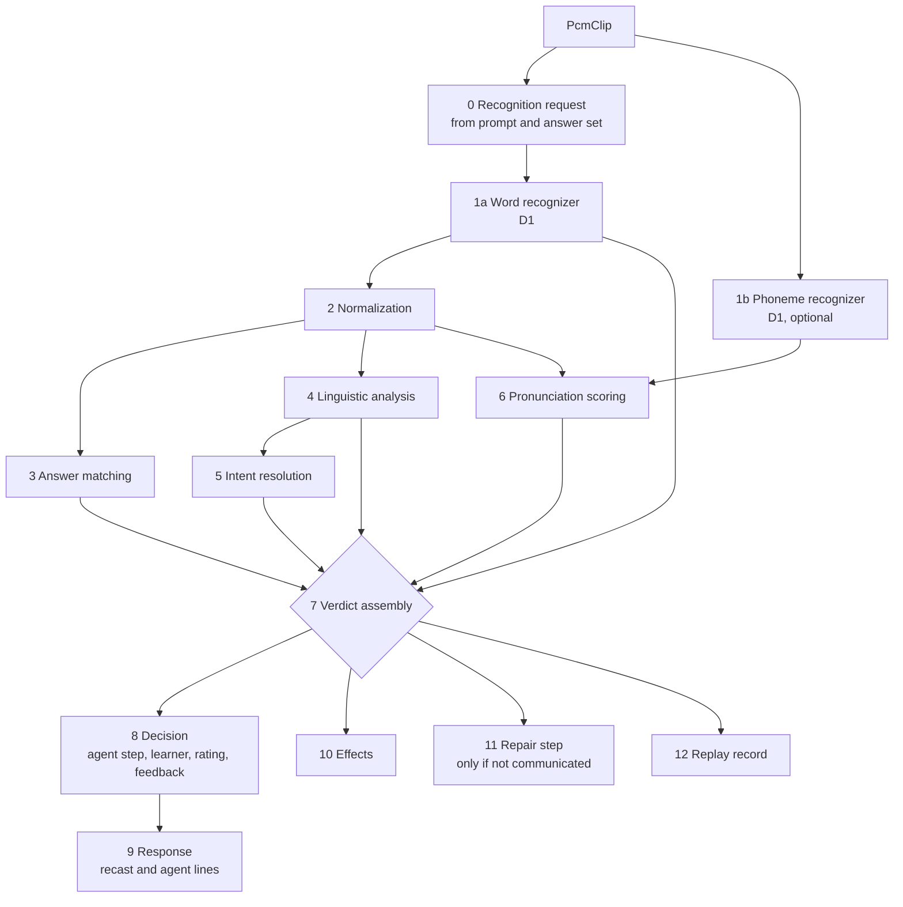

# The utterance pipeline

`Vocaterra.Nlp.Pipeline.UtterancePipeline` turns one recorded utterance into everything the host needs to react: a graded **verdict**, the
agent's and learner model's **decision**, the **lines** the agent says, the **effects**, an optional **repair** step and a
**replay record**. This page walks through `Evaluate` stage by stage, using the worked example from the high-level design
(`HIGH_LEVEL_DOCS.md`, "Verdict contract and error taxonomy"), and shows the actual output of the CLI for it.

- [The call](#the-call)
- [The stages at a glance](#the-stages-at-a-glance)
- [The worked example](#the-worked-example)
- [Stage by stage](#stage-by-stage)
- [The verdict the CLI prints](#the-verdict-the-cli-prints)
- [Other branches](#other-branches)
- [Guarantees](#guarantees)
- [Run it yourself](#run-it-yourself)

## The call

```csharp
var services = new PipelineServices(wordRecognizer, phonemeRecognizer /* or null */, embeddings /* or null */, synthesizer /* or null */, contentBundle);
var pipeline = new UtterancePipeline(services);                       // optional PipelineOptions second argument
PipelineResult result = pipeline.Evaluate(clip, prompt, context);     // or pipeline.Trace(...) to also get the recognizer outputs
```

| Input | Type | What it is |
| --- | --- | --- |
| `clip` | `PcmClip` | 16 kHz mono 16-bit samples plus their SHA-256 `ClipHash`. Produced by `AudioFrontEnd` (resample, downmix, gain, energy VAD) from a push-to-talk capture or a WAV file. |
| `prompt` | `PromptSpec` | What the host asked: prompt id, recognition mode (`Constrained` or `Open`), difficulty, answer set id, allowed intent ids, agent id and slot grammar ids. Prompts are data (`content/v1/prompts/prompts.json`). |
| `context` | `ConversationContext` | The host state it is evaluated in: world seed, agent id and state, stored time, the learner model, repeat counts per error tag. Nothing in it comes from a clock. |

`PipelineResult` has six members: `Verdict`, `Decision`, `Response`, `Effects`, `Repair` and `Replay`. `Trace` returns a
`PipelineTrace` that adds the word recognizer's `AsrResult` and the phoneme recognizer's `PhonePosteriors`, which is what a
[replay log](REPLAY.md) stores.

Models are optional. Without a phoneme recognizer there is no pronunciation scoring; without an embedding model the third intent
rung is skipped; without a synthesizer only `Synthesize` fails. The word recognizer and the content bundle are required.

## The stages at a glance



| # | Stage | Class | Code | Skipped when |
| --- | --- | --- | --- | --- |
| 0 | Recognition request | D0 | `GrammarBuilder.BuildList` | never |
| 1 | Word recognition; phoneme recognition | D1 | `IWordRecognizer`, `IPhonemeRecognizer` | no phoneme recognizer |
| 2 | Normalization | D0 | `TextNormalizer.Normalize` | never |
| 3 | Answer matching | D0 | `AnswerMatcher.Match` | never (result `None` if nothing matches) |
| 4 | Linguistic analysis | D0 | `LinguisticAnalyzer.Analyze` | never |
| 5 | Intent resolution | D0, plus one D1 rung | `IntentResolver.Resolve` | the prompt allows no intent (answer-only prompt) |
| 6 | Pronunciation scoring | D1 model, D0 scoring | `PronunciationScorer.Score` | no phoneme recognizer, or no frames |
| 7 | Verdict assembly | D0 | `VerdictAssembler.Assemble` | never |
| 8 | Decision | D0 | `Decide` in `UtterancePipeline.Response.cs` | agent step skipped when the bundle has no state machine for the agent |
| 9 | Response realization | D0 | `ResponsePlanner`, `RecastBuilder` | never (may be empty) |
| 10 | Effects | D0 | `EffectResolver.Resolve` | never (may be empty) |
| 11 | Repair | D0 | `RepairStrategy.Next` | the player was understood |
| 12 | Replay record | D0 | `ReplayRecord` | never |

## The worked example

At the blacksmith, the player says "yo tiene dos espada" ("I has two sword": the verb is in the wrong person and the noun is
singular after a number). The high-level design expects: intent `offer_item`, slots `item=espada, qty=2`, communicated `true`,
errors `conj.person` (tiene to tengo) and `noun.number` (espada to espadas), and a recast from the player's own words:
"¿Tienes dos espadas? ¡Perfecto!"

The inputs, as the CLI builds them for `--prompt offer-items-open` with no other options:

```json
{
  "promptId": "offer-items-open",
  "mode": "Open",
  "difficulty": "Intermediate",
  "answerSetId": "items-basic",
  "allowedIntentIds": ["offer_item"],
  "agentId": "blacksmith",
  "slotGrammarIds": [
    "[VERB:tener:verb] [NUM:qty] [NOUN:item]",
    "[PRON]? [VERB:ofrecer:verb] [NUM:qty] [NOUN:item]"
  ]
}
```

The conversation context is: world seed 0, agent `blacksmith` in state `idle` with interaction counter 0, stored time 0, a fresh learner
model, no repeat counts. The word recognizer is a `ScriptedWordRecognizer` that returns the text given with `--transcript`;
the clip is empty, so there is no phoneme recognizer and no pronunciation scoring.

## Stage by stage

The intermediate values below were printed by running each stage on the example with the shipped `content/v1` bundle.

### 0. Recognition request

`BuildRequest` looks up the prompt's answer set (an unknown answer set id is an `ArgumentException`) and builds what the word
recognizer is asked to do.

- **Constrained** prompts get a closed phrase list: every canonical answer and alias of the answer set, lower-cased, NFC,
  stripped of punctuation, de-duplicated and ordinal-sorted, followed by `[unk]`. For `spell-cast-constrained`:
  `{"mode":"Constrained","grammarPhrases":["bola de fuego","el escudo mágico","el fuego","el hielo","el rayo","escudo de magia","escudo mágico","fuego","hielo","lanza de hielo","rayo","relámpago","un escudo mágico","un rayo","un relámpago","una bola de fuego","una lanza de hielo","[unk]"],"maxAlternatives":5}`.
- **Open** prompts get no phrase list. `offer-items-open` is open: `{"mode":"Open","grammarPhrases":[],"maxAlternatives":5}`.

### 1. Recognition (D1)

The word recognizer (`IWordRecognizer`: Vosk with the grammar for constrained prompts, Parakeet through sherpa-onnx for open
ones) returns an `AsrResult`: transcript, n-best list, word timings, confidence, model hash and mode. If a phoneme recognizer is
present it runs on a second task at the same time and returns `PhonePosteriors`. Both results are consumed in a fixed order, so
the scheduling cannot change the output (`PipelineOptions.RunRecognizersConcurrently` can turn the concurrency off).

For the example: `{"transcript":"yo tiene dos espada", "nBest":[{"text":"yo tiene dos espada","score":1}], "words":[], "confidence":1, "modelHash":"scripted-transcript", "mode":"Open"}`.

### 2. Normalization (D0)

The transcript loses any `[unk]` markers, then `TextNormalizer.Normalize` lower-cases it, applies Unicode NFC, strips punctuation
(keeping `ñ` and accents), and turns number words into digits. The pipeline passes `ConvertIndefiniteArticles = false`:
the normalizer's default would turn `una espada` into `1 espada`, which would hide the article from the agreement checks and the
`[ART]` grammar tokens. Every token keeps its span in the normalized text and its original word.

`yo tiene dos espada` becomes the text `yo tiene 2 espada` with four tokens: `yo` (0, 2), `tiene` (3, 5), `2` (9, 1, original `dos`)
and `espada` (11, 6). The spans in the verdict's errors refer to this normalized text.

### 3. Answer matching (D0)

`AnswerMatcher.Match` compares the normalized text with the prompt's answer set, cheapest first: exact (canonical answers),
alias, then fuzzy (Damerau-Levenshtein on a Spanish phonetic key, with a maximum distance that grows with the phrase length and
the difficulty). A near miss with a distance of 0 on the phonetic key is flagged `likelyPronunciation`: the player knew the word.
The rule for near misses (budget, confidence, communication and the expected word of an unknown word) is in [Near misses](#near-misses).


For the example: `{"answerId":null,"type":"None","distance":9,"likelyPronunciation":false,"confidence":0}`. The sentence is
not one of the five items on its own, which is expected for a sentence prompt. For a quiz answer such as `espada` on
`quiz-item-name` the match is `Exact` with confidence 1.

### Near misses

A near miss is a spelling close to an answer phrase, on any prompt whose answer set can match. One rule decides it (M17c; the
fuzzy stage of `AnswerMatcher` and `AnswerCorrections` implement it, and the fuzz oracle O6 checks it against an independent model):

- **Budget.** The distance `d` is the smaller of the spelling and the phonetic Damerau-Levenshtein distance to a canonical or alias
  phrase. The budget is `floor(length / divisor)`, with the phrase's length in characters after stripping accents and the divisor
  4, 5 or 6 for Beginner, Intermediate and Advanced. The budget is **inclusive**: `d <= budget` is a fuzzy match and `d > budget` is
  not. At Beginner a phrase of 4 to 7 characters allows one edit, so `espado` (one letter off `espada`) is a match on its edge.
- **Confidence.** A fuzzy match has confidence `1 - d/length`, the same at the budget's edge as inside it: one slip in a six-letter
  answer gives 0.83. (Before M17c the edge had a fixed confidence of 0.5, which the communicated margin rejects; that was the bug.)
- **Communication.** A fuzzy match is communicated with `resolvedBy: Fuzzy`, and its confidence is the verdict's confidence (the
  minimum of the stage confidences). With the shipped thresholds (0.6 with epsilon 0.02) no fuzzy match within budget is rejected,
  because its confidence is at least 0.75.
- **Vocabulary.** An unknown word of a near miss (a `vocab.unknown` error) takes the canonical word of the matched answer as its
  `expected`, so the recast says the answer. Its spelling is the canonical one, with accents (`pocion` gives `poción`). A one-word
  input takes the whole canonical phrase (`buenosdias` gives `buenos días`). Otherwise the unknown word takes the canonical word it is
  nearest to (accent-insensitive distance, the earlier word on a tie), so `una ezpada` gives `espada` and the recast reads `una espada`. Words the lexicon knows are never changed.
- **Inflected forms.** The matcher compares spelled phrases, so an inflection that is a lexicon form (`espadas` for `espada`) is a
  near miss by spelling: it is communicated at confidence 0.83 with no error tag, and `correctness` stays 1. The alternative, an
  `Exact` match with `noun.number`, would need the matcher to read the lexicon, and an answer-only prompt has no grammar to check
  the number with. This is a known limit, to revisit with the analyzer work.

Why `ezpada`, `espado` and `yelo` behaved differently (M17c investigation): a six-letter answer at Beginner has a budget of one edit.
`ezpada` is one letter from `espada`, but the phonetic key maps `z` to `s` (seseo), so its distance is 0 and it is a full-confidence
match. `espado` is one edit from `espada` and `yelo` is one phonetic step from `hielo` (`hielo` keys to `ielo`); both sit exactly on the
budget's edge. The edge was reported with confidence 0.5, which the communicated margin rejected. The budget itself was right; the
fixed confidence at its edge was not.

### 4. Linguistic analysis (D0)

`LinguisticAnalyzer` looks every token up in the lexicon (lemma, part of speech, person, number, tense, mood, gender; an
empty reading list means an unknown word and yields `vocab.unknown`), runs the agreement rules (subject and verb, article and
noun, noun and adjective, quantity and noun, `ser`/`estar`, adjective position), and matches the slot grammars. The grammars
tried are the prompt's own `slotGrammarIds` first (they win ties), then every other grammar of the allowed intents.

**One reading per word.** A word the lexicon reads as several parts of speech is resolved to one before the rules run, so that
`libro` (a noun, and a form of `librar`) is not checked as both. `ReadingResolver` does it in three steps, and every rule then runs
on the resolved readings only. The returned tokens still list all readings, because the intent stage matches lemmas on them.

1. **Local syntax** (hard constraints, repeated until nothing changes). After an article, numeral or possessive come further
   determiners and adjectives and then a noun (`un libro`, `dos libro`, `una buena lanza`); an adjective that does not follow a noun
   is prenominal, so a noun follows it (`correcto paseo`); a quantifier that is also an adverb (`mucho`) before a noun is the
   determiner, and so is an adjective-and-adverb word before a noun that cannot be a verb (`temprano pasillo`; `solo agua` is the
   exception, `solo` is an adverb that goes before nouns); the word after a subject pronoun or a clitic (skipping adverbs and
   clitics) is a verb (`yo lanza`, `tú ayudas`); the word after a preposition, and the complement of `ser`/`estar`, is not a finite
   verb (`a casa`, `la casa es grande`); an interjection reading is the last resort (the lexicon lists `sus` and `sé` as
   interjections too). A rule fires on a word only when every reading it has is of the kind that triggers it (an article, not
   the clitic `la`), and only when a reading of its neighbour fits. `ayer`, `anoche` and `anteayer` change nothing here: a word
   after an article is a noun with or without them (`ayer compré un libro`).
2. **Grammar bindings.** When a slot grammar matched the whole utterance, each word was consumed by a grammar element, and the
   words local syntax left open take its reading: `[NOUN:item]` keeps the noun readings, `[VERB:comprar]` the readings of that verb,
   a literal that matched through a lemma (`querer` for `quiero`) the readings of that lemma. A literal spelled like the word
   (`lanza`, `tardes`) constrains nothing, because the author wrote a form and not a reading; a word that tied parses read in
   different ways keeps what any of them accepts. The bindings come after the local rules: a grammar ignores agreement and accepts a
   modifier where a noun is needed, so where the two disagree the neighbouring words win (`yo lanza` matches
   `[VERB:lanzar]? [ART]? [NOUN:spell]` with `lanza` as the noun, and is still a `conj.person` mistake). The grammar is matched first
   for this reason, on all readings; the slots come from that match.
3. **Charitable fallback.** The words that are still ambiguous take the class combination for which the rules report the fewest
   errors (finite verb, infinitive or participle, noun, adjective, determiner, pronoun, adverb, ...). A sentence without any
   finite verb counts as two errors when it has a past-time adverb, so a verb form next to `ayer` is not read as a noun to
   make its tense mistake disappear (`ayer canto una canción`); a sentence of nouns and adjectives with no adverb of the past is not
   charged, because it has no verb and is fine. Ties go to the earlier class in the lexicon's reading order. Up to 256 combinations are tried
   exhaustively; a longer sentence is settled word by word (at most four passes). The two hard steps are what keep this from
   swallowing an injected error, and the mutation oracle O4 of the fuzz suite is the guard.

Not resolved: two verbs that share a form (`fue` is `ir` and `ser`) are one class, and a sentence that is a mistake under one
reading and correct under another, with nothing to prefer either, is read the charitable way (`ayer … intenciones parte`).

Grammar matching works on lemmas and ignores agreement (agreement is what the rules check), and it allows a leading subject
pronoun. So for the example the first grammar `[VERB:tener:verb] [NUM:qty] [NOUN:item]` fits `yo tiene 2 espada`, and the analysis is
(readings abbreviated):

```json
{
  "tokens": [
    {"token": {"text": "yo", "span": {"start": 0, "length": 2}, "original": "yo"},
     "readings": [{"lemma": "yo", "pos": "pron", "person": "1", "number": "sg"}]},
    {"token": {"text": "tiene", "span": {"start": 3, "length": 5}, "original": "tiene"},
     "readings": [{"lemma": "tener", "pos": "verb", "person": "3", "number": "sg", "tense": "pres", "mood": "ind"}]},
    {"token": {"text": "2", "span": {"start": 9, "length": 1}, "original": "dos"},
     "readings": [{"lemma": "2", "pos": "num", "number": "pl"}]},
    {"token": {"text": "espada", "span": {"start": 11, "length": 6}, "original": "espada"},
     "readings": [{"lemma": "espada", "pos": "noun", "number": "sg", "gender": "f"}]}
  ],
  "slots": [
    {"name": "verb", "value": "tener", "span": {"start": 3, "length": 5}},
    {"name": "qty", "value": "2", "span": {"start": 9, "length": 1}},
    {"name": "item", "value": "espada", "span": {"start": 11, "length": 6}}
  ],
  "errors": [
    {"tag": "conj.person", "span": {"start": 3, "length": 5}, "expected": "tengo", "actual": "tiene"},
    {"tag": "noun.number", "span": {"start": 11, "length": 6}, "expected": "espadas", "actual": "espada"}
  ],
  "matchedGrammarId": "[VERB:tener:verb] [NUM:qty] [NOUN:item]",
  "confidence": 1
}
```

`yo` is first person, so the third-person `tiene` is a `conj.person` error whose expected form comes from the morphology
generator (`tengo`). The plural quantity `2` makes the singular `espada` a `noun.number` error (`espadas`).

### 5. Intent resolution (D0 plus an optional D1 rung)

`IntentResolver` tries three rungs in a fixed order and stops at the first that is confident: the slot grammar that matched in
stage 4, then lemma keyword rules (lemma `comprar` plus an item gives `buy_item`), then the embedding nearest neighbour against
the authored example utterances, accepted only if `top1 >= t` and `top1 - top2 >= m` (both with margins). If nothing resolves,
the intent is `unknown` with confidence 0.

**Answer-only prompts skip this stage.** A prompt whose `allowedIntentIds` is empty (a quiz such as `quiz-item-name`) only asks
for an answer; its answer match is its resolution, and no intent grammar may claim the utterance.

For the example the grammar rung resolves it: `{"intent":"offer_item","slots":{"item":"espada","qty":"2","verb":"tener"},"rung":"Grammar","margin":1,"confidence":1}`.
The catalog says `offer_item` needs the slots `item` and `qty`, both filled.

A leading adverb defeats the grammars: they allow a leading subject pronoun only, so `ayer tengo dos espadas` matches no grammar. The
`offer_item` intent therefore has a keyword rule for `ofrecer` and one for `tener`, each requiring `item` and `qty`. Such an utterance
resolves on the `Rules` rung, and the analysis still reports the tense (`conj.tense`, `tengo` to `tuve`).

### 6. Pronunciation scoring (D1 model, D0 scoring)

Only when a phoneme recognizer produced frames. The normalized text has its digits spelled out (the G2P drops digits:
`2` becomes `dos`), `SpanishG2p.PhonemizeAll` yields the accepted phone sequences for every shipped dialect (ADR 0005), the
predicted English-speaker error variants are generated from them, and `PronunciationScorer` (CTC forced alignment and goodness of
pronunciation by default) scores each phone of the best-matching variant and turns low scores into `pron.*` errors with margins.

In the CLI example there is no phoneme recognizer, so `pronunciation` is `[]`. The end-to-end golden test
(`tests/Vocaterra.Nlp.Golden.Tests/Data/e2e-offer-items-open.golden.json`) runs the same utterance with a fake phoneme recognizer that
hears the correct phones: the verdict then lists one `PhoneScore` per content phone, each with score 1.

### 7. Verdict assembly (D0)

`VerdictAssembler.Assemble` is a pure function of the earlier outputs, the prompt, the required slots of the resolved intent, the
evaluation configuration and the version stamp:

- **intent** and **slots**: the intent stage's, with the analysis slots underneath (the intent wins a name clash).
- **communicated**: the intent is known, every required slot is filled and the confidence is not rejected by the communicated
  margin; or the answer set matched (exact, alias or fuzzy) with a confidence that is not rejected. An *uncertain* confidence
  counts as communicated: the host rewards being understood. A fuzzy match at the edge of its budget has the confidence of its
  distance, so it is communicated like any other near miss (see [Near misses](#near-misses)).
- **errors**: analysis errors, pronunciation errors and the derived `vocab.wrong`, de-duplicated by (tag, span) and sorted by
  span start, then tag order in the taxonomy, then expected text. The derived `vocab.wrong` (a word the lexicon knows but the answer
  set does not contain) has as `expected` the answer set's canonical answer when the set has exactly one answer, and an empty
  `expected` otherwise; its `actual` is the word. A `vocab.unknown` of a fuzzy answer match already carries the canonical word.
- **correctness**: 1 minus the sum of the error weights for the prompt's difficulty (`content/v1/evaluation/evaluation-config.json`),
  clamped to [0, 1], rounded to 9 decimals. For the intermediate difficulty `conj.person` costs 0.3 and `noun.number` 0.2, so
  1 - 0.3 - 0.2 = 0.5.
- **confidence**: the minimum of the stage confidences (recognizer, answer match when something matched, analysis, intent, pronunciation).
- **resolvedBy**: the answer match type when there was one, otherwise the intent rung (`Grammar`, `Rules`, `Embedding`), otherwise `Unresolved`.
- **versions**: the content hash and the model hashes of the services.

### 8. Decision (D0)

`Decide` produces a `DecisionOutcome` with four parts:

1. **agent step.** The agent's state machine (`content/v1/agents/blacksmith.json`) reads the verdict and the agent's current state and
   returns the next state and a list of actions (dialogue intent, host event, variant index). The only randomness is the draw for
   the variant, from `SeededRng.ForInteraction(worldSeed, agentId, interactionCounter)`. For the example: `idle` goes to `trading`,
   with the action `offer_item_reply` and the host event `trade.offer`.
2. **Learner model.** One Bayesian knowledge tracing step per skill: the skill `intent.<intent>` and the family of each error tag
   (`conj`, `noun`). Here `conj` and `noun` drop to a probability known of about 0.146 and `intent.offer_item` rises to about 0.693.
3. **FSRS rating.** `RatingMapper.FromVerdict`: not communicated is `Again`; otherwise correctness is compared with the 0.5 and
   0.9 cut-offs (each with a 0.02 margin; an uncertain score rounds down). Correctness 0.5 is inside the band around 0.5, so the
   rating is `Hard`.
4. **Feedback plan.** `FeedbackPolicy.Plan` gives each error the most specific rule for (tag, repeat count, difficulty). The first
   offence of anything is a recast, the second and third a hint, the fourth and later an explicit correction, and any `pron.*`
   error from the second offence on a model pronunciation. At most two items are kept. Here: a recast for `conj.person` and
   a recast for `noun.number`.

### 9. Response realization (D0)

`ResponsePlanner` renders the lines the agent says from the dialogue catalog (`content/v1/dialogue/dialogue.json`). The first
feedback item is voiced; for a recast the pool is `feedback.recast.<tag>`, falling back to `feedback.recast`. The
`feedback.recast.conj.person` templates (`¿{verb:conj(2,sg,pres):cap} {qty:words(item)} {item:plural-if(qty)}? ¡Perfecto!` and
`Ah, ¿{verb:conj(2,sg,pres)} {qty:words(item)} {item:plural-if(qty)}? ¡Muy bien!`) take the player's own slots and inflect
them with the morphology generator: the verb is conjugated for the second person and the noun is pluralized according to the
quantity. Generic recast templates can instead use `{recast}`, the corrected sentence that `RecastBuilder` rebuilds from the
player's tokens and the expected forms in the analysis. The recast also restores accents: a word the lexicon knows only once its
accents are ignored takes the lexicon's accented spelling (`dias` becomes `días`, so `buenas dias` is recast as `buenos días`). When
several accented spellings fold alike the first in ordinal order is used. A word that is a lexicon form as spelled is kept, so `se`
stays `se` (it is not `sé`), and `mas` stays `mas`. For the example the draw gives "Ah, ¿tienes dos espadas? ¡Muy bien!" with
world seed 0 and with seed 42. If a feedback template needs a slot the verdict does not have, the pipeline falls back from the
specific pool to the generic pool of the same kind, and then to no feedback, so a content gap never silences the agent.

The agent's own reply comes from the action's pool (`offer_item_reply`), using the variant index drawn in stage 8: "Vale, dos
espadas. Gracias, amigo." with world seed 0 and "¡Dos espadas! Trato hecho." with seed 42.

A prompt without an agent is not a conversation: nobody replies, only feedback is voiced, except that an acceptable answer to such a
prompt (a quiz) gets a line from the `answer_accepted` pool.

### 10. Effects (D0)

`EffectResolver.Resolve` looks up the verdict's intent in the effect table (`content/v1/effects/effects.json`) and interpolates
a value from the correctness curve: a spell's power, a trade's price factor. Partial credit gives a partial effect. The worked
example has none (`offer_item` has no effect in the sample table), so `effects` is `[]`. Casting a spell does: see below.

Effects depend on the verdict alone, not on the agent's state: a purchase in the blacksmith's `done` state still emits `buy_item_price`,
so the host gates effects by state (the host decides whether a trade is allowed at that point).

### 11. Repair (D0)

If the player was not understood, `RepairStrategy.Next(attempt, prompt, phrases)` returns the deterministic repair ladder step.
The attempt number is the repeat count of the pseudo-tag `not_communicated` from the conversation context (at least 1): attempt 1 is
`AskAgain` ("¿Cómo?"), attempt 2 `SlowRepeat`, attempt 3 `OfferChoices` (the first three distinct phrases of the answer set in
ordinal order, with a constrained retry request), later attempts `GiveUp`. For understood utterances `repair` is `null`.

### 12. Replay record (D0)

`ReplayRecord(clip.ClipHash, prompt.PromptId, context.HostStateHash, versions, verdict)` is attached to the result. With
`Trace`, the recognizer outputs and the context are what [`docs/REPLAY.md`](REPLAY.md) calls an envelope.

## The verdict the CLI prints

This is the first line the CLI prints for the worked example, pretty-printed here (the CLI prints it on one line):

```bash
dotnet run --project tools/Vocaterra.Nlp.Cli -- eval --transcript "yo tiene dos espada" --prompt offer-items-open --content content/v1
```

```json
{
  "intent": "offer_item",
  "slots": {
    "item": "espada",
    "qty": "2",
    "verb": "tener"
  },
  "communicated": true,
  "correctness": 0.5,
  "errors": [
    {
      "tag": "conj.person",
      "span": { "start": 3, "length": 5 },
      "expected": "tengo",
      "actual": "tiene"
    },
    {
      "tag": "noun.number",
      "span": { "start": 11, "length": 6 },
      "expected": "espadas",
      "actual": "espada"
    }
  ],
  "pronunciation": [],
  "confidence": 1,
  "resolvedBy": "Grammar",
  "versions": {
    "contentHash": "d45b8012dde06bdd54039c4857849709a88e96e11802b960f5c5b36795a26b3f",
    "modelHashes": {
      "asr": "scripted-transcript"
    }
  }
}
```

After the verdict the CLI prints the agent lines and a decision summary:

```text
agent: Ah, ¿tienes dos espadas? ¡Muy bien!
agent: Vale, dos espadas. Gracias, amigo.
decision: rating Hard, learner skills 3, feedback items 2
```

It matches the high-level design: intent `offer_item`, `item=espada`, `qty=2`, communicated, and the two errors with the expected forms
`tengo` and `espadas`. Two details differ from the sketch in the design document, both by design: the slot map also carries
`verb=tener` (the matched grammar names its verb slot so that a recast can conjugate it), and the recast is one of two seeded
variants, "¿Tienes dos espadas? ¡Perfecto!" (the design document's line, which the end-to-end golden test produces for its seed
and interaction counter) or "Ah, ¿tienes dos espadas? ¡Muy bien!" (the draw for the CLI's default context).

The content hash is the hash of the `content/v1` bundle. It changes with any edit to the bundle (see `CONTRIBUTING.md`); the
tests pin it in `tests/Vocaterra.Nlp.Content.Tests/ManifestTests.cs`.

## Other branches

Each of these is a real run of the CLI on `content/v1` (verdict line shortened).

| Command (after `eval`) | Verdict | Printed after the verdict |
| --- | --- | --- |
| `--transcript "espada" --prompt quiz-item-name` | intent `unknown`, communicated, correctness 1, `resolvedBy: Exact`, no errors (answer-only prompt) | `agent: ¡Muy bien!` and `decision: rating Easy, learner skills 0, feedback items 0` |
| `--transcript "fuego" --prompt spell-cast-constrained` | intent `cast_spell`, slot `spell=fuego`, communicated, correctness 1, `resolvedBy: Exact` | `agent: ¡Muy bien!`, `effect: cast_spell_power spell_power 1`, `decision: rating Easy, learner skills 1, feedback items 0` |
| `--transcript "ezpada" --prompt quiz-item-name` | intent `unknown`, communicated, correctness 0.6, one `vocab.unknown` with expected `espada`, `resolvedBy: Fuzzy`, confidence 0.5 (a near miss, see [Near misses](#near-misses)) | `agent: Ah, espada. ¡Perfecto!` and `decision: rating Good, learner skills 1, feedback items 1` |
| `--transcript "bla bla" --prompt offer-items-open` | intent `unknown`, not communicated, correctness 0.2, two `vocab.unknown` errors, `resolvedBy: Unresolved`, confidence 0 | `agent: Perdón, ¿qué dices?`, `repair: AskAgain ¿Cómo?`, `decision: rating Again, learner skills 1, feedback items 1` |
| the same with `--repeat not_communicated=2` | as above | `repair: SlowRepeat Perdón, te lo repito más despacio.` |
| the same with `--repeat not_communicated=3` | as above | `repair: OfferChoices ¿Quieres decir «arco», «brebaje» o «el arco»?` |

The first row shows the answer-only rule: a quiz answer with no intent is still `communicated`, because the answer set matched.
The second shows a host effect, a spell cast at full power because correctness is 1 (the curve in `effects.json` gives 0.5 power at
correctness 0.5).

## Guarantees

- **Fixed order.** The stages run in the order above. Word and phoneme recognition may run on two tasks, but their results are
  consumed in a fixed order and no stage shares mutable state with another.
- **Pure after recognition.** Everything from stage 2 on is a function of the recognizer outputs, the prompt, the context and the
  content bundle. The only randomness is the seeded draw in stages 8 and 9, seeded from the context.
- **Same inputs, same bytes.** Two evaluations with the same clip, prompt, context and services give results whose
  `CanonicalJson` is identical; `UtterancePipeline` keeps no state between utterances, so one instance can serve many.
- **Replayable.** The recognizer outputs plus the context are enough to reproduce the result without the models.
- **Margins, not knife edges.** Intent acceptance, communication, pronunciation and the FSRS rating all use `Margin` bands with
  an explicit uncertain branch (ADR 0002).

## Run it yourself

```bash
dotnet run --project tools/Vocaterra.Nlp.Cli -- eval --transcript "yo tiene dos espada" --prompt offer-items-open --content content/v1
```

Add `--seed <n>` (world seed), `--now <unixSeconds>`, `--agent-state <id>` (start the agent in a given state), `--counter <n>`
(interaction counter), `--repeat <tag>=<n>` (repeat counts) and `--replay-out <file>` to control the conversation context and record the
run. `dotnet run --project tools/Vocaterra.Nlp.Cli -- --help` prints the full usage. The prompt ids in the sample bundle are `ask-price-open`,
`buy-item-constrained`, `buy-item-open`, `greet-blacksmith`, `greet-open`, `offer-items-constrained`, `offer-items-open`,
`quiz-greeting-name`, `quiz-item-name`, `quiz-spell-name`, `sell-item-open`, `spell-cast-constrained`, `spell-cast-open` and
`trade-free-conversation`.
